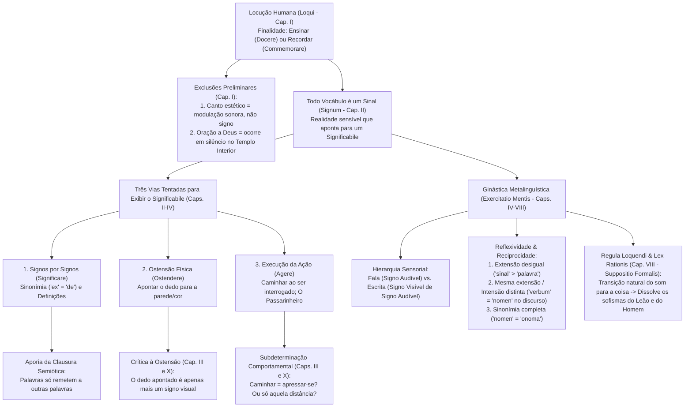
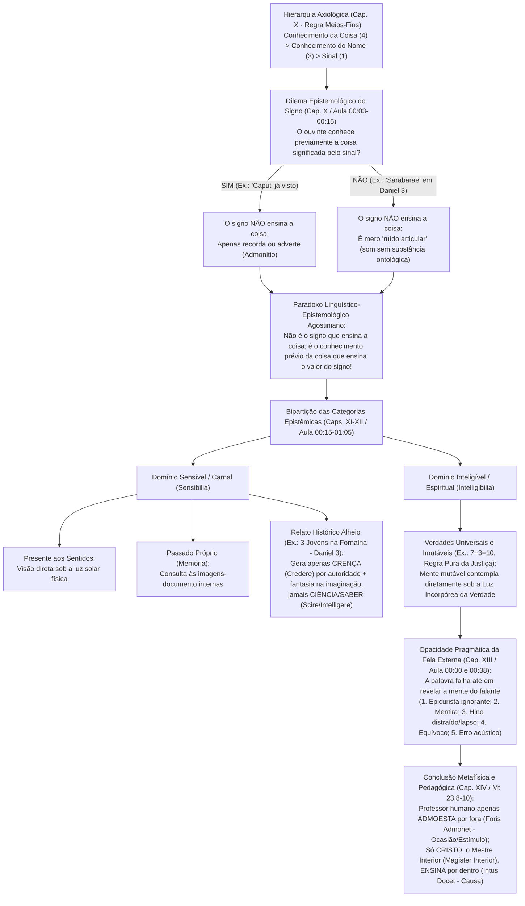

# Dossiê Exegético Integral (`philo-exegesis` — Modo A): *De Magistro* de Santo Agostinho & Pontes com a Aula de Filosofia Medieval (04/11)

> **Protocolo Metodológico Ativado (`philo-exegesis` v2 — Modo A Híbrido):**
> - **Perfil 1 (`estrutural.md`):** Exegese Estrutural Franco-Brasileira em **5 Fases (Fase 0 → Fase 4)** — Victor Goldschmidt (*tempo lógico* e os 4 movimentos dialéticos), Martial Gueroult (*ordem das razões* e deslocamento semântico), René Descartes (4 Regras do Método), M. A. González Porta, Frédéric Cossutta, Marilena Chaui, Marcus Sacrini e Robert Brandom (*De Dicto / De Re*).
> - **Perfil 6 (`filosofia-da-linguagem.md`):** Protocolo Híbrido em **4 Camadas** — (1) Filológica e Terminológica + *Uso vs. Menção*; (2) Analítica (Quebra-Cabeça Semiótico, Forma Padrão e Contraexemplos); (3) Estrutural (Cadeia de Dependência e Mapas 2D Mermaid); (4) Contextual/Genética (Estoicismo, Peripatetismo, Sexto Empírico, Platão, Coseriu, Horn, Burnyeat, Wittgenstein e Fodor).
> - **Convenção Visual das Pontes com a Aula (`Transcricao_Medieval_04-11.md`):** Todos os pontos de conexão direta entre a exegese do *De Magistro* e a preleção do professor (incluindo a retomada da **aula anterior**) estão marcados em **<mark style="background-color: #fff176; color: #111111; padding: 2px 6px; border-radius: 4px; font-weight: 600;">destaque amarelo</mark>** e acompanhados de caixas amarelas com a **transcrição integral e literal** da explicação do professor e seu respectivo marcador temporal (`[HH:MM:SS]`).

---

## Sumário Arquitetônico do Dossiê

1. **[Mapa Sinóptico das 11 Pontes entre o *De Magistro* e a Aula do Professor](#1-mapa-sinóptico-das-11-pontes-entre-o-de-magistro-e-a-aula-do-professor)**
2. **[Fase 0: Diagnóstico do Problema, Gênero e Ancoragem Contextual (Porta / Skinner / Chaui)](#2-fase-0-diagnóstico-do-problema-gênero-e-ancoragem-contextual)**
3. **[Fase 1 & Camada 1 (Filológica): Glossário de Restrições Conceituais (CSC), Uso vs. Menção e Mapa Enunciativo (Cossutta)](#3-fase-1--camada-1-filológica-glossário-de-restrições-conceituais-csc-uso-vs-menção-e-mapa-enunciativo)**
4. **[Fase 2: Movimentos Estruturais — *Tempo Lógico* e *Ordem das Razões* nos 14 Capítulos do *De Magistro* (com todas as Pontes em Amarelo e Transcrições da Aula)](#4-fase-2-movimentos-estruturais--tempo-lógico-e-ordem-das-razões-nos-14-capítulos-do-de-magistro)**
5. **[Fase 3 & Camadas 2–3 (Analítica e Estrutural): Reconstrução em Forma Padrão Anotada (`P1...Pn ⊢ C`), Checagem de Enumeração e Mapas 2D (Mermaid)](#5-fase-3--camadas-23-analítica-e-estrutural-reconstrução-em-forma-padrão-anotada-enumeração-e-mapas-2d)**
6. **[Fase 4 & Camada 4 (Contextual/Genética): Síntese Zero-Jargão, Caridade Hermenêutica e Crítica *De Dicto* vs. *De Re* (Wittgenstein, Coseriu, Horn, Burnyeat e o *Verbum Mentis*)](#6-fase-4--camada-4-contextualgenética-síntese-zero-jargão-caridade-hermenêutica-e-crítica-de-dicto-vs-de-re)**

---

## 1. Mapa Sinóptico das 11 Pontes entre o *De Magistro* e a Aula do Professor

| # | Tema da Aula (e Retomada da Aula Anterior) | Timestamp na Gravação | Localização Canônica no *De Magistro* (e Corpus) | Núcleo da Conexão Exegética (<mark style="background-color: #fff176; color: #111111; padding: 2px 5px; border-radius: 3px;">Ponte em Destaque</mark>) |
| :-: | :--- | :---: | :--- | :--- |
| **P1** | **<mark style="background-color: #fff176; color: #111111; padding: 2px 5px; border-radius: 3px;">[Aula Anterior + Abertura] Dúplice Finalidade da Linguagem e Tradição Clássica (Platão e Estoicos)</mark>** | `[00:00:00 – 00:03:00]` | `DM I, 1–2`; `II, 3–4`; `IV, 7–9`; `XIII, 42–44` (*cf. De Dialectica* V) | <mark style="background-color: #fff176; color: #111111; padding: 2px 5px; border-radius: 3px;">A palavra como *signum* material (som/tinta no quadro) instituído com dupla função: ser **sinal da coisa externa** (*res*) e **sinal do conteúdo mental** (*dicibile*/afecção da alma), herdando a semiótica do *Sofista/Teeteto* de Platão e da dialética estoica.</mark> |
| **P2** | **<mark style="background-color: #fff176; color: #111111; padding: 2px 5px; border-radius: 3px;">A "Concepção Agostiniana da Linguagem" em Wittgenstein vs. Dupla Inovação de Agostinho (Negativa e Positiva)</mark>** | `[00:00:00 – 00:03:00]` | `DM II, 3–4`; `III, 5–6`; `X, 29–35`; `XI, 38` (*cf. Conf.* I, 8, 13; Wittgenstein, *IF* § 1) | <mark style="background-color: #fff176; color: #111111; padding: 2px 5px; border-radius: 3px;">Wittgenstein identifica em Agostinho o modelo referencialista/ostensivo da linguagem; porém, o *De Magistro* rompe com a tradição ao introduzir uma **abordagem negativa** (crítica epistemológica radical à suficiência do signo) e uma **contribuição positiva** (solução metafísica da Iluminação).</mark> |
| **P3** | **<mark style="background-color: #fff176; color: #111111; padding: 2px 5px; border-radius: 3px;">Tese Radical ("Os Sinais Não Ensinam Nada") e o Dilema Epistemológico do Signo</mark>** | `[00:03:00 – 00:08:00]` | `DM X, 33–35`; `XI, 36` (*cf.* Sexto Empírico, *PH* III, 267–269; Platão, *Mênon* 80d–e) | <mark style="background-color: #fff176; color: #111111; padding: 2px 5px; border-radius: 3px;">Dilema bicorne: (1) se o ouvinte já conhece a coisa significada, o signo não ensina, apenas recorda/adverte (*admonitio*); (2) se não conhece, a palavra é mero *"ruído articular"* incapaz de exibir a substância ontológica do objeto.</mark> |
| **P4** | **<mark style="background-color: #fff176; color: #111111; padding: 2px 5px; border-radius: 3px;">O Exemplo de *Sarabarae* (Daniel 3) e o Paradoxo Linguístico-Epistemológico Agostiniano</mark>** | `[00:08:00 – 00:15:00]` | `DM X, 33–35` (exemplos de *saraballae / sarabarae* e *caput*) | <mark style="background-color: #fff176; color: #111111; padding: 2px 5px; border-radius: 3px;">Ouvir as sílabas `"sa-ra-ba-ra"` nada ensina a quem nunca viu a veste persa; **é o conhecimento prévio da coisa que torna possível compreender o signo**, e não o signo que causa o conhecimento da coisa.</mark> |
| **P5** | **<mark style="background-color: #fff176; color: #111111; padding: 2px 5px; border-radius: 3px;">Crer (*Credere*) vs. Compreender/Saber (*Intelligere / Scire*) e os Três Jovens na Fornalha (Daniel 3)</mark>** | `[00:15:00 – 00:22:00]` | `DM XI, 37` (Ananias, Azarias e Misael na fornalha de Nabucodonosor; *Isaías 7,9*) | <mark style="background-color: #fff176; color: #111111; padding: 2px 5px; border-radius: 3px;">Diante de relatos históricos contingentes que não presenciamos pelos sentidos nem intuímos *a priori*, só podemos **crer** (*credere*) por autoridade testemunhal, jamais **saber/compreender** (*scire/intelligere*), que exige evidência direta de primeira pessoa.</mark> |
| **P6** | **<mark style="background-color: #fff176; color: #111111; padding: 2px 5px; border-radius: 3px;">Memória e Imaginação (Fantasias Subjetivas do Sensível) vs. Verdades Inteligíveis Puras (`7 + 3 = 10` e Justiça)</mark>** | `[00:22:00 – 00:30:00]` | `DM XII, 39–40` (imagens-documento na memória vs. contemplação noética) | <mark style="background-color: #fff176; color: #111111; padding: 2px 5px; border-radius: 3px;">No relato da fornalha, a imaginação compõe imagens subjetivas na memória a partir de experiências prévias (homens + fogo); já verdades matemáticas e o conceito puro de Justiça não têm cor, cheiro nem imagem física, sendo contemplados no intelecto.</mark> |
| **P7** | **<mark style="background-color: #fff176; color: #111111; padding: 2px 5px; border-radius: 3px;">Direito Positivo vs. Essência Noética da Justiça como Regra Interior de Julgamento</mark>** | `[00:30:00 – 00:38:00]` | `DM XII, 40`; `XIII, 43`; `XIV, 45` (julgamento interior da verdade e da virtude) | <mark style="background-color: #fff176; color: #111111; padding: 2px 5px; border-radius: 3px;">Para julgar se uma lei positiva ou ação particular é *justa*, a mente aplica uma regra interior e imutável de retidão que não entra pelos ouvidos através das ondas sonoras da fala externa.</mark> |
| **P8** | **<mark style="background-color: #fff176; color: #111111; padding: 2px 5px; border-radius: 3px;">Função Admonitória (*Admonitio*) do Professor Exterior e Crítica à Pedagogia do "Vaso Vazio"</mark>** | `[00:38:00 – 00:45:00]` | `DM XI, 36`; `XI, 38`; `XII, 40`; `XIV, 45–46` | <mark style="background-color: #fff176; color: #111111; padding: 2px 5px; border-radius: 3px;">O mestre exterior não "injeta" nem derrama ideias na mente do aluno como num vaso vazio; suas palavras são apenas **admoestações** (*admonitio*) que convidam o discípulo a voltar o olhar para dentro de si.</mark> |
| **P9** | **<mark style="background-color: #fff176; color: #111111; padding: 2px 5px; border-radius: 3px;">Leitura Exegética Direta de *DM* XI–XII: Mestre Interior (*Christus*) e Teoria da Iluminação (*Illuminatio*)</mark>** | `[00:45:00 – 01:05:00]` | `DM XI, 38`; `XII, 39–40`; `XIV, 45–46` (*1 Cor 1,24*; *Ef 3,16–17*; *Mt 23,8–10*) | <mark style="background-color: #fff176; color: #111111; padding: 2px 5px; border-radius: 3px;">Assim como o olho corporal precisa da luz do sol para ver corpos, a mente mutável precisa da Luz Incorpórea de Deus para contemplar verdades imutáveis; só Cristo (*Magister Interior*) ensina no íntimo da alma.</mark> |
| **P10** | **<mark style="background-color: #fff176; color: #111111; padding: 2px 5px; border-radius: 3px;">Objeção sobre Pensamento e Linguagem: O Verbo Interior (*Verbum Cordis*) e Ocasião vs. Causa Eficiente</mark>** | `[01:05:00 – 01:12:00]` | `DM I, 2`; `XI, 38`; `XIV, 46` + Desdobramento em *De Trinitate* XV, 10, 18 – 11, 20 | <mark style="background-color: #fff176; color: #111111; padding: 2px 5px; border-radius: 3px;">A palavra sonora é a **ocasião/estímulo**, não a **causa eficiente e formal** do compreender; no *De Trinitate*, Agostinho explicita o *verbum cordis / mentis* (palavra mental pré-linguística, anterior ao latim, grego ou hebraico).</mark> |
| **P11** | **<mark style="background-color: #fff176; color: #111111; padding: 2px 5px; border-radius: 3px;">Reminiscência Platônica (*Anamnese* no *Mênon/Fédon*) vs. Presença Transcendente (*Interior Intimo Meo*)</mark>** | `[01:12:00 – 01:17:37]` | `DM XII, 40` (aprendizado gradual por interrogação maiêutica) (*cf. Conf.* III, 6, 11; *De Trin.* XII, 15, 24) | <mark style="background-color: #fff176; color: #111111; padding: 2px 5px; border-radius: 3px;">Agostinho rejeita a preexistência temporal da alma e a metempsicose platônica: consultar a Verdade não é recordar um passado pré-natal, mas voltar-se para uma Presença divina atual e contínua no íntimo da mente.</mark> |

---

## 2. Fase 0: Diagnóstico do Problema, Gênero e Ancoragem Contextual

*(Protocolo: M. A. González Porta / H.-G. Gadamer / Q. Skinner / M. Chaui)*

### 2.1. Gênero e Estatuto da Fonte (Chaui / Hadot)
- **Obra:** *De Magistro* (*Do Mestre*), diálogo filosófico-pedagógico em 14 capítulos (46 parágrafos na divisão beneditina/canônica; pp. 1–54 do PDF / pp. 319–356 da edição *Os Pensadores*).
- **Datação e Contexto Histórico:** Composto em Tagaste (Norte da África) por volta de **389 d.C.** (três anos após a conversão de Agostinho e a redação do tratado inacabado *De Dialectica* em 386, e pouco antes do falecimento precoce de seu filho Adeodato).
- **Estatuto Psicagógico e Dramático:** Como atesta o próprio Agostinho em *Confissões* IX, 6, 14, seu interlocutor é seu filho **Adeodato**, então com cerca de 16 anos, cuja inteligência prodigiosa o pai registra com reverência (*"tu sabes que são dele todos os pensamentos que ali se atribuem ao meu interlocutor, quando tinha dezesseis anos"*). Seguindo a tradição antiga estudada por **Pierre Hadot** e **Victor Goldschmidt**, o diálogo não é uma exposição dogmática linear, mas uma ***exercitatio mentis*** (ginástica espiritual e dialética, explicitamente tematizada em `DM VIII, 21`): a primeira metade (`Caps. I–X, 31`) conduz o interlocutor por um longo desvio semiótico e metalinguístico (*détour méthodologique*) para purificar a mente da ilusão do senso comum antes da ascensão noética e teológica da segunda metade (`Caps. X, 32 – XIV, 46`).

### 2.2. Tema e Problema Central (Aporia Geradora — Porta)
- **Tema:** Filosofia da Linguagem, Semiótica Metalinguística e Epistemologia do Ensino e da Compreensão (*intellegere*).
- **Problema (Aporia Central):** **Como é possível que a linguagem verbal — instituída especificamente para ensinar (*docere*) e recordar (*commemorare*) mediante sinais (*signa*) — seja, ao mesmo tempo, estruturalmente incapaz de fazer alguém aprender (*discere*) ou conhecer (*scire*) qualquer realidade que já não conhecesse previamente?**
  - Esse problema desdobra-se em três tensões encadeadas na *ordem das razões*:
    1. **Aporia Semiótica (Clausura dos Signos, Caps. I–VIII):** Se toda palavra é um sinal (*signum*) que remete a outra coisa, como explicar palavras por palavras sem ficar aprisionado num círculo fechado de signos que remetem a outros signos — e como evitar os paralogismos que nascem quando a linguagem fala de si mesma (metalinguagem)?
    2. **Aporia Axiológica e Ostensiva (Caps. IX–X):** Se o conhecimento da coisa é teleologicamente superior ao signo e se nem o gesto ostensivo (apontar o dedo) nem a execução física de uma ação (caminhar) escapam da ambiguidade, como se rompe a barreira entre o ruído sonoro e a realidade extralinguística?
    3. **Aporia Epistemológica do Magistério (Caps. X–XIV):** Se o signo pressupõe o conhecimento prévio do objeto para adquirir significado (*sarabara / caput*), e se as palavras não garantem sequer o acesso infalível ao pensamento do próprio falante (mentira, erro, lapso, equívoco), quem realiza efetivamente o ato de ensinar quando um discípulo compreende uma verdade?

### 2.3. Interlocutores e Adversários (Força Ilocucionária — Skinner)
No contexto intelectual da Antiguidade Tardia, o ato de fala filosófico de Agostinho intervém simultaneamente em quatro frentes polêmicas:
1. **Contra a Semântica Peripatética Restritiva (e em diálogo crítico com a Dialética Estoica):** Contra os peripatéticos (que restringiam a significação própria aos nomes e verbos, tratando preposições e conjunções como vazias ou meramente co-significativas), Agostinho mobiliza a tese estoica de que toda palavra possui uma contribuição semântica nomeável (*dictio*), mas subverte o naturalismo etimológico estoico (e do *Crátilo* platônico) em favor de um **convencionalismo semiótico** (*thesei*).
2. **Apropriação e Subversão do Ceticismo Pirrônico (Sexto Empírico, *PH* III, 267–269):** Como demonstrou Christoph Horn, Agostinho apropria-se do *"dilema do aprendizado baseado na palavra"* do ceticismo pirrônico (se já conheço a coisa, a palavra não ensina; se não a conheço, o signo convencional nada revela), mas **inverte sua força ilocucionária**: onde o cético pirrônico usava o dilema para destruir a possibilidade do saber e impor a suspensão do juízo (*epoché*), Agostinho o utiliza para destruir apenas a pretensão causal do **mestre exterior**, abrindo caminho para a certeza interior da iluminação.
3. **Contra o Materialismo Epicurista e o Ceticismo Moral (Cap. XIII, 41–42):** Ao exemplificar como um epicurista (que crê ser a alma mortal) pode recitar argumentos válidos em favor da imortalidade da alma e fazer com que um ouvinte espiritual reconheça a verdade desses argumentos, Agostinho dissocia radicalmente a verdade objetiva contemplada na mente da posse subjetiva dessa verdade pelo locutor humano.
4. **Reinterpretação Cristã do Platonismo (*Mênon* e *Teeteto*) e do Preceito Evangélico (*Mt 23,8–10*):** Agostinho substitui a reminiscência pré-natal platônica (*anámnēsis*) pela presença interior atual do *Logos* divino (Cristo, Sabedoria e Virtude incomutável de Deus, *1 Cor 1,24*), conferindo fundamentação epistemológica rigorosa à sentença de Jesus: *"Não queirais ser chamados mestres na terra, porque um só é o vosso Mestre, o Cristo"*.

### 2.4. Tese Central e Pressupostos
- **Tese Central:** Nenhum sinal exterior (verbal, escrito ou gestual) e nenhum professor humano possuem força causal constitutiva para ensinar (*docere*) o conhecimento (*scientia / intellegere*) de uma realidade a outrem: no plano sensível, são as próprias coisas percebidas pelos sentidos que ensinam o valor dos sinais; no plano inteligível, as palavras humanas exercem unicamente uma função de **admoestação externa** (*admonitio*), incitando a alma racional a voltar-se para seu próprio interior e contemplar diretamente a verdade sob a iluminação do único **Mestre Interior** (*Magister Interior*, Cristo).
- **Pressupostos Estruturais:**
  1. **Dualismo Ontológico e Epistêmico Platônico-Cristão:** A realidade cognoscível divide-se exaustivamente em coisas *sensíveis/carnais* (percebidas pelos sentidos do corpo) e coisas *inteligíveis/espirituais* (percebidas pela mente/*mens* na luz interior).
  2. **Epistemologia da Primeira Pessoa:** Compreender (*intellegere*) é um ato intransferível de visão direta (sensorial ou intelectual); o testemunho alheio sobre o que não vemos gera **crença** (*credere*), jamais **ciência** (*scire*).
  3. **Teleologia Axiológica Meios-Fins:** Todo instrumento instituído em vista de um fim possui valor ontológico inferior ao fim para o qual existe (`DM IX, 25–26`).

---

### <mark style="background-color: #fff176; color: #111111; padding: 2px 6px; border-radius: 4px;">PONTE 1 & PONTE 2 COM A AULA (E RETOMADA DA AULA ANTERIOR) [00:00:00 – 00:03:00]</mark>

**Pontos de Conexão Exegética em Destaque:**
1. <mark style="background-color: #fff176; color: #111111; padding: 2px 5px; border-radius: 3px;">**Retomada da Aula Anterior — A Dúplice Finalidade Fenomênica da Linguagem:**</mark> Na abertura da aula, o professor retoma o que havia explicado na **aula passada**: a linguagem humana possui uma dúplice finalidade semiótica — **(a) ser sinal da coisa externa** (*res* / objeto material sensível observado) e **(b) ser sinal do conteúdo mental** (*dicibile* / o que está na mente de quem fala para a mente do interlocutor). No *De Magistro*, Agostinho parte exatamente dessa dupla dimensão (`DM I, 1–2` e `II, 3`, onde analisa tanto termos referenciais quanto partículas como *"se"*, que indicam um estado mental de dúvida na alma, para depois mostrar nos `Caps. X–XIII` que a linguagem é insuficiente em **ambos** os casos: não exibe a coisa em si no `Cap. X` e falha até mesmo em manifestar com transparência o conteúdo mental do falante no `Cap. XIII`!).
2. <mark style="background-color: #fff176; color: #111111; padding: 2px 5px; border-radius: 3px;">**A Definição Clássica (Platão, Aristóteles, Estoicos) e a "Concepção Agostiniana" em Wittgenstein vs. A Dupla Inovação de Agostinho:**</mark> O professor conecta a definição agostiniana do signo material (exemplificada pela tinta do pincel atômico sobre o quadro de vidro) à tradição do *Sofista* e do *Teeteto* de Platão (*logos* como expressão do pensamento na alma), à dialética estoica e à abertura das *Investigações Filosóficas* de Wittgenstein. E crava o diagnóstico estrutural da Fase 0: a originalidade de Agostinho divide-se em uma **abordagem negativa** (crítica epistemológica radical à capacidade da linguagem de ensinar) e uma **contribuição positiva** (solução metafísica pela Iluminação / Mestre Interior).

**Transcrição Literal da Explicação do Professor (`[00:00:00 – 00:03:00]`):**
> *"...o que está na minha mente para a mente do meu interlocutor. Essa seria, como nós analisamos na aula passada, a dúplice finalidade da linguagem: **ser sinal da coisa** e **ser sinal do conteúdo mental** daquele que utiliza a linguagem.*  
>  
> *O Agostinho verifica que, para esses dois casos, a linguagem nos parece ser insuficiente. Porque a linguagem é entendida como sinal (*signum*), ou seja, como uma espécie de símbolo, um elemento material cuja finalidade fenomênica é apontar para uma outra coisa. É por isso que nós ensinamos por meio de palavras. Olha: eu vou construir... eu manipulei sinais materiais, ou seja, a tinta do piloto que imprime o seu corante sobre o quadro de vidro. E essa impressão segue um certo padrão. Por exemplo, eu traço esse padrão e esse padrão... posso fazer uma associação de padrões.*  
>  
> *Este sinal aponta para o significado, de acordo com Agostinho. E esse significado pode ser um objeto material sensível observado, ou este significado pode ser um conteúdo mental.*  
>  
> *Esse modo de compreender a linguagem — ou seja, uma manipulação material de um sinal que aponta para o significado mental ou para um objeto externo — é exatamente aquilo que Wittgenstein identificou nas Investigações Filosóficas como a concepção agostiniana da linguagem: em certa medida, a linguagem é uma espécie de correspondência significativa com o mundo.*  
>  
> *Essa descrição da linguagem encontra vários correlatos ao longo da história da filosofia: já no Sofista e no Teeteto de Platão, por exemplo, encontramos essa definição da linguagem como instrumento que significa ou aponta para aquilo que ocorre na alma (logos como expressão do pensamento). Essa compreensão não é uma exclusividade agostiniana; ela se encontra também nas obras lógicas e dialéticas da tradição estóica.*  
>  
> *O que há de novo em Agostinho nesse ponto? Por que Agostinho, nessa longeva tradição sobre a filosofia da linguagem, merece uma atenção especial? Eu diria que há uma abordagem negativa — na medida em que Agostinho apresenta uma crítica contundente à função da linguagem — e uma contribuição positiva, que é como ele resolve esse problema. Agostinho herda a imagem instrumental/sígnica da linguagem, mas, de maneira propositiva e inovadora, acrescenta uma crítica epistemológica radical e uma solução metafísica."*

---

## 3. Fase 1 & Camada 1 (Filológica): Glossário de Restrições Conceituais (CSC), Uso vs. Menção e Mapa Enunciativo

*(Protocolo: Controlled Semantic Cognition [Lambon Ralph et al.] / Frédéric Cossutta / Descartes Regra 1 / Camada 1 de Filosofia da Linguagem)*

### 3.1. Tabela de Restrição Conceitual e Precisão Filológica Latina

Para impedir a fadiga de controle semântico (reversão silenciosa de termos técnicos patrísticos e estoicos para o sentido vulgar contemporâneo), fixamos as restrições estritas do vocabulário de Agostinho no *De Magistro* (em cotejo com *De Dialectica*, *De Doctrina Christiana* e *De Trinitate*):

| Termo Original Latino | Sentido Comum / Armadilha de Tradução (Inibir) | Sentido Técnico Estrito no *De Magistro* (Restrição) | Oposições Conceituais & Conexão com a Aula |
| :--- | :--- | :--- | :--- |
| ***Signum*** (Sinal / Signo) | Qualquer indício vago ou símbolo gráfico isolado. | Toda realidade material perceptível pelos sentidos (som vocal, letra escrita, gesto, insígnia militar) que, além da impressão física que produz, faz vir ao pensamento outra coisa (`DM II, 3; IV, 9`; *cf. De Doctr. Chr.* II, 1, 1). | vs. ***Significabile / Res*** (a realidade significável que não é signo). <mark style="background-color: #fff176; color: #111111; padding: 1px 4px; border-radius: 3px;">Na aula (`[00:00:00]`): elemento material (como a tinta do piloto no quadro) cuja finalidade fenomênica é apontar para outra coisa.</mark> |
| ***Significabile*** (Significável) | "Aquilo que tem sentido importante". | Qualquer realidade (corpórea, espiritual ou até outro signo) que pode ser significada por meio de sinais sem ser, necessariamente, ela própria um sinal (`DM IV, 7–8; VII, 20`). | vs. ***Signum*** enquanto mero veículo material. Base da distinção entre linguagem-objeto e metalinguagem. |
| ***Verbum*** (Palavra / Verbo) | Apenas "palavra" genérica ou apenas a classe gramatical dos verbos. | Possui **dupla acepção técnica** controlada por Agostinho: **(1) Sentido Geral:** qualquer emissão de voz articulada proferida com algum significado (etimologicamente vinculada por Agostinho a *verberare* — "ferir/afrontar o ar e o ouvido", `DM V, 12`); **(2) Sentido Gramatical Estrito:** a parte do discurso declinada por tempos (*escrevo, escrevi, leio, li*, `DM IV, 9`). | vs. ***Nomen*** (vinculado a *nosco*, conhecer) e vs. ***Dictio*** (a palavra tomada na unidade concreta de som + significado, *De Dialectica* V). |
| ***Nomen*** (Nome / Substantivo) | Apenas nome próprio de pessoa ou substantivo concreto comum. | **(1) Na gramática estrita (`sprachliche Metasprache`):** uma das oito partes da oração que se declina por casos (`DM IV, 9`); **(2) Na metalinguagem do discurso (`Metasprache der Rede`):** toda e qualquer palavra (inclusive conjunções como *si* e *quia*, verbos ou pronomes) quando mencionada como objeto do discurso e sujeito nominativo de uma proposição (`DM V, 11–16`). | Etimologia cognitiva agostiniana: *nomen* deriva de *nosco* (conhecer), pois imprime a coisa na memória (`DM V, 12`). |
| ***Dicibile* vs. *Dictio* vs. *Res*** (*De Dialectica* V → *De Magistro*) | Sinônimos genéricos de "palavra" e "coisa". | **Tétrade Semiótica Agostiniana:** (1) ***Verbum***: palavra enquanto som físico mencionada por si; (2) ***Dicibile***: o conteúdo mental/conceitual apreendido no espírito antes da voz (*cf. lekton* estoico); (3) ***Dictio***: a palavra na unidade de som + significado visando a coisa; (4) ***Res***: o referente significado. | <mark style="background-color: #fff176; color: #111111; padding: 1px 4px; border-radius: 3px;">Explica exatamente a **dúplice finalidade da linguagem** retomada pelo professor da aula anterior (`[00:00:00]`): apontar para a *res* (objeto sensível) e para o *dicibile* (conteúdo mental).</mark> |
| ***Regula loquendi* & *Lex rationis*** (`DM VIII, 23–24`) | Regra gramatical escolar de sintaxe. | A **lei natural da razão** gravada na mente humana segundo a qual, no uso normal da comunicação, a atenção do ouvinte transita imediatamente do sinal sonoro para a realidade significada (antecipação da ***suppositio formalis*** escolástica, contra a ***suppositio materialis***). | Dissolve os sofismas do **leão** que sai da boca e do **homem** composto de duas sílabas (`DM VIII, 22–24`). |
| ***Ostendere* vs. *Agere* vs. *Significare*** (`DM III, 5–6; X, 29–34`) | Modos equivalentes de "explicar". | Três vias investigadas para exibir uma realidade: **(1) *Ostendere***: apontar corpos presentes (que, todavia, ainda usa o gesto como signo); **(2) *Agere***: executar a própria ação diante de quem pergunta (ex.: andar, falar); **(3) *Significare***: indicar por sinais verbais ou não-verbais. | Agostinho demonstra que nem *ostendere* (apontar o dedo é apenas sinal da indicação) nem *agere* (caminhar é subdeterminado) escapam da ambiguidade. |
| ***Docere*** (Ensinar: *Telling* vs. *Showing*) | Passar conteúdo escolar ou dar aula. | Termo cujo deslocamento semântico comanda a virada do diálogo (Burnyeat / Coseriu): na 1ª parte (`Caps. I–X, 31`), é tomado como *dizer/transmitir sinais* (*teaching by telling*); na 2ª parte (`Caps. X, 32–XIV, 46`), é restringido estritamente a *causar/exibir a compreensão direta da verdade* (*teaching by showing*). | vs. ***Admonere / Admonitio*** (a única função real que resta à fala humana externa). |
| ***Admonitio / Admonere*** (Admoestação / Advertência) | "Dar uma bronca" ou repreensão moral. | Estímulo, aviso ou ocasião auditiva externa pela qual o sinal sonoro convida a alma racional a direcionar seu olhar para a realidade sensível ou para a Verdade interior (`DM XI, 36, 38; XIV, 45–46`). | <mark style="background-color: #fff176; color: #111111; padding: 1px 4px; border-radius: 3px;">Na aula (`[00:03:00]`, `[00:38:00]`, `[01:05:00]`): o professor enfatiza que a palavra externa é *ocasião/estímulo* (*admonitio*), jamais *causa eficiente e formal* do saber.</mark> |
| ***Credere*** vs. ***Intelligere / Scire*** | "Ter fé religiosa cega" vs. "ter informação factual". | ***Credere* (Crer):** assentir com a vontade a um testemunho ou autoridade acerca de fatos ausentes aos sentidos e à razão (ex.: história dos três jovens na fornalha, `DM XI, 37`). ***Intelligere / Scire* (Compreender / Saber em sentido próprio):** contemplação direta, evidente e sinóptica da verdade presente à mente (`DM XI, 37–38; XII, 40`). | Fórmula de `DM XI, 37`: *"Tudo o que compreendo conheço, mas nem tudo que creio conheço"* (apoiada em *Isaías 7,9* LXX). <mark style="background-color: #fff176; color: #111111; padding: 1px 4px; border-radius: 3px;">Eixo da Parte II da aula (`[00:15:00–00:30:00]`).</mark> |
| ***Magister Interior* & *Illuminatio*** | "Consciência psicológica subjetiva" ou "intuição pessoal criativa". | Cristo enquanto *Logos*, Virtude incomutável e Sabedoria eterna de Deus (*1 Cor 1,24*) que habita no homem interior (*Ef 3,16–17*) e ilumina a mente criada mutável com a Luz incorpórea das verdades eternas (`DM XI, 38; XII, 40; XIV, 45–46`). | <mark style="background-color: #fff176; color: #111111; padding: 1px 4px; border-radius: 3px;">Eixo da Parte IV e V da aula (`[00:45:00–01:17:37]`): opõe-se à *anamnese* pré-natal platônica por ser Presença transcendente contínua (*interior intimo meo*).</mark> |
| ***Verbum Mentis / Verbum Cordis*** (*De Trinitate* XV) | Pensar em silêncio usando palavras em português ou latim. | A palavra mental pré-convencional (*cogitatio* gerada na *intelligentia* a partir da *notitia* da *memoria*), dotada de estrutura discursivo-predicativa, universal e anterior a qualquer idioma histórico (latim, grego ou hebraico). | <mark style="background-color: #fff176; color: #111111; padding: 1px 4px; border-radius: 3px;">Mobilizado pelo professor no debate final (`[01:05:00–01:12:00]`) para responder à objeção do aluno sobre pensamento e linguagem.</mark> |

---

### 3.2. Análise Filológica de Uso vs. Menção (*Use vs. Mention*) no *De Magistro*
Como destaca a Camada 1 do protocolo de Filosofia da Linguagem (e os estudos de Coseriu/Lermen, Horn e Burnyeat presentes no diretório), o *De Magistro* (`Caps. IV–VIII`) realiza uma façanha lógica sem precedentes na Antiguidade: **construir uma teoria formal da metalinguagem numa cultura manuscrita que não dispunha de aspas tipográficas**.
- **O Duplo Nível Metalinguístico (Coseriu 1975):**
  1. ***Sprachliche Metasprache* (Metalinguagem Linguística):** Termos de segunda ordem do léxico que nomeiam classes de signos (`"sinal"`, `"palavra"`, `"nome"`, `"verbo"`, `"conjunção"`). Aqui, `"nome"` é reflexivo (nomeia a classe dos nomes e pertence a ela), ao passo que `"conjunção"` é irreflexivo (o vocábulo `"conjunção"` é um substantivo/nome, mas os elementos que ele denota — *se, ou, porque* — são conjunções e não substantivos, `DM V, 11`).
  2. ***Metasprache der Rede* (Metalinguagem do Discurso):** Qualquer palavra da língua tomada autonomamente como objeto de discurso (menção autônima), passando a funcionar sintaticamente como um substantivo neutro (sujeito nominativo de um verbo), como quando Agostinho formula no `Cap. V, 16`: ***Placet si; displicet quia*** (*"'Se' agrada; 'porque' desagrada"*).
- **A Sutileza da *Dictio* (Burnyeat 1987):** Quando Agostinho menciona `"se"` em *"Se agrada"*, ele não está mencionando apenas o ruído físico de uma sílaba (*verbum* em sentido estrito / pura menção material), mas a palavra **investida de sua função significativa condicional** (*dictio* / *suppositio semantica*).

### 3.3. Mapa Enunciativo e Metáforas Estruturantes (Cossutta)
1. **Distribuição das Vozes no Diálogo:**
   - **Agostinho (Condutor Maiêutico e Sistemático):** Na 1ª Parte (`Caps. I–X, 31`), atua como interrogador socrático que testa as definições de Adeodato, introduz objeções aparentes e chega a armar armadilhas dialéticas deliberadas (como os sofismas do `Cap. VIII` e a generalização inválida do `Cap. X, 31`) para exercitar o rigor do filho; na 2ª Parte (`Caps. XI, 36–XIV, 46`), assume a voz expositiva contínua (*oratio perpetua*).
   - **Adeodato (Interlocutor Filosófico Ativo):** Longe de ser um figurante passivo, introduz restrições decisivas: (a) a objeção do canto estético e das flautas/aves (`Cap. I, 1`); (b) a tese de que *"nada"* significa a afecção da mente que busca algo e não o encontra (`Cap. II, 3`); (c) a recusa em aceitar o sofisma de que um homem seja duas sílabas (`Cap. VIII, 22`); (d) a objeção estética de que o nome `"lama"` (*coenum*) soa quase como `"céu"` (*coelum*) e é superior à coisa fétida (`Cap. IX, 25`); (e) a aguda crítica à subdeterminação ostensiva do ato de caminhar (`Cap. X, 29`); e (f) a ratificação autorreferencial final (`Cap. XIV, 46`).
   - **Vozes Encenadas / Adversários Hipotéticos:** O sofista gracejador que diz sair um leão da boca (`Cap. VIII, 23`); o comilão repreendido por viver para comer (`Cap. IX, 26`); o espectador do passarinheiro (`Cap. X, 32`); e o cético epicurista que expõe argumentos sobre a imortalidade da alma sem crer neles (`Cap. XIII, 41–42`).
2. **Quatro Metáforas-Raiz que Estruturam a Arquitetura Conceitual:**
   - **Os Dedos Entrelaçados que se Coçam (`DM V, 14`):** Metáfora corporal da **reflexividade metalinguística** — falar de palavras com palavras mistura de tal modo o signo que fala e o signo de que se fala que só quem move os dedos sabe qual dedo coça e qual é coçado.
   - **Os Degraus de Ascensão e a Ginástica da Mente (`DM VIII, 21`):** A análise semiótica preliminar não é um brinco pueril, mas um treino de forças (*exercitatio mentis*) para suportar o calor e a luz da vida bem-aventurada.
   - **O Caçador de Pássaros (`DM X, 32`):** Paradigma da aprendizagem observacional de primeira mão (*teaching by showing*) em contraste com a exibição cósmica do sol e da lua por Deus e pela natureza.
   - **O Templo Interior e a Luz Solar vs. Luz Incorpórea (`DM I, 2; XI, 38; XII, 39–40`):** Metáfora arquitetônica e óptica de matriz paulina (*1 Cor 3,16*) e neoplatônica (*República* VI / Plotino) — a câmara secreta da mente onde habita Cristo como Sol inteligível que ilumina as verdades eternas.

---

## 4. Fase 2: Movimentos Estruturais — *Tempo Lógico* e *Ordem das Razões* nos 14 Capítulos do *De Magistro*

*(Protocolo: Victor Goldschmidt / Martial Gueroult / Descartes Regras 2 e 3)*

O tratado desenvolve-se através de **quatro grandes movimentos dialéticos** que correspondem com precisão cirúrgica aos **4 Movimentos de Goldschmidt**:
1. **Movimento I (`Caps. I–III`) — *A Imagem / Doxa e o Elenchus da Clausura Semiótica*:** Da opinião inicial de que falamos para ensinar por palavras até a aporia de que sinais só remetem a outros sinais.
2. **Movimento II (`Caps. IV–VIII`) — *O Détour Méthodologique (A Ginástica Metalinguística)*:** O longo desvio técnico pelos sinais que significam sinais (*verbum*, *nomen*, reflexividade, reciprocidade e *regula loquendi*).
3. **Movimento III (`Caps. IX–X`) — *O Pivô Axiológico, a Crise Aporética e a Inversão Pirrônico-Platônica*:** Da superioridade do conhecimento sobre o signo ao contraexemplo do passarinheiro e à descoberta de que **nada se aprende pelos sinais** (*sarabara* e *caput*).
4. **Movimento IV (`Caps. XI–XIV`) — *A Essência / Ciência (A Epistemologia da Primeira Pessoa e o Mestre Interior)*:** A distinção entre *credere* e *intelligere* (os jovens na fornalha), a iluminação interior das verdades eternas, as cinco opacidades pragmáticas da fala e a conclusão sobre o magistério exclusivo de Cristo.

Abaixo, reconstruímos passo a passo a **Ordem das Razões** de cada movimento e capítulo, integrando em **<mark style="background-color: #fff176; color: #111111; padding: 2px 5px; border-radius: 3px;">destaque amarelo</mark>** todas as conexões e transcrições literais da aula do professor.

---

### Movimento I (Capítulos I–III): A Pragmática da Locução e o Fechamento do Universo dos Signos (*Doxa → Aporia Inicial*)

#### Passo 1.1. Capítulo I (`DM I, 1–2`): A Finalidade da Fala e as Três Contra-Objeções (Pergunta, Canto e Oração)
- **Função Arquitetônica:** Fixar a definição funcional inicial (*doxa* qualificada) da linguagem humana: *"Que te parece que pretendemos fazer quando falamos?"* — **ou ensinar (*docere*), ou aprender/recordar (*discere / commemorare*)**.
- **Teste Dialético das Objeções:**
  1. **O ato de perguntar (`DM I, 1`):** Quando perguntamos para aprender, ainda assim falamos para *ensinar* ao interlocutor o que desejamos saber.
  2. **O canto solitário por prazer estético (`DM I, 1`):** Adeodato objeta que cantamos muitas vezes sozinhos apenas por deleite, sem querer ensinar nem lembrar nada. Agostinho distingue então a **modulação musical do som** (comum às flautas e aos pássaros, que agrada ao ouvido) da **locução significativa** (*loqui*): cantar enquanto música não é falar enquanto uso de signos.
  3. **A prece religiosa e o Pai-Nosso (`DM I, 2`):** Se Deus já conhece o íntimo da alma antes que falemos (*Mt 6,8*), por que Cristo nos ensinou as palavras da oração? Agostinho responde que, na oração autêntica, **não falamos a Deus com palavras exteriores**, mas oramos nos *"aposentos fechados"* do espírito — o **templo interior da mente** (*1 Cor 3,16*). Quando pronunciamos palavras audíveis na oração, fazemo-lo apenas para **recordar a nós mesmos** ou **admoestar (*admonere*) os outros homens** a elevarem o pensamento a Deus.
- **Necessidade de Transição (*Ordem das Razões*):** A análise da prece já planta no Capítulo I a semente de toda a conclusão do Capítulo XIV: **a interioridade da mente como templo de Deus** e a redução das palavras sonoras a mero instrumento de **recordação/admoestação** (*commemoratio / admonitio*). Mas, para provar isso demonstrativamente, Agostinho precisa primeiro investigar o que são as palavras enquanto **sinais** (*signa*).

#### Passo 1.2. Capítulo II (`DM II, 3–4`): Toda Palavra é Sinal e a Aporia das Partículas Sincategoremáticas (*Virgílio, Eneida II, 659*)
- **Função Arquitetônica:** Estabelecer o axioma semiótico fundamental — **toda palavra é um sinal (*signum*), e nenhum sinal pode ser sinal se não significar alguma coisa (*nisi aliquid significet*)** — e submetê-lo imediatamente a um teste de estresse mediante o verso de Virgílio (*Eneida* II, 659):
  > ***Si nihil ex tanta superis placet urbe relinqui***  
  > (*"Se nada de tão grande cidade agrada aos deuses que seja deixado"*)
- **O Quebra-Cabeça Semântico das 3 Primeiras Palavras (`DM II, 3–4`):**
  1. ***Si* ("Se"):** Conjunção condicional. Que coisa ela significa? Não aponta para nenhum corpo físico; Adeodato propõe que significa a **dúvida** (*dubitatio*), e Agostinho aceita provisoriamente que seu significado reside na **alma** (conteúdo mental / disposição subjetiva do espírito).
  2. ***Nihil* ("Nada"):** Se todo sinal significa *algo*, como pode `"nada"` significar o que não existe? Adeodato tenta dizer que significa o que não existe, mas Agostinho o bloqueia com o princípio parmenídico-platônico: *o que não existe não pode ser alguma coisa*. Logo, a palavra `"nada"` não aponta para uma "coisa inexistente", mas para a **afecção da própria mente** (*affectionem animi*) que procura um objeto, constata que ele não existe (ou não está ali) e exprime essa frustração cognitiva.
  3. ***Ex* ("De"):** Preposição ablativa. Adeodato tenta explicá-la substituindo-a pelo sinônimo ***de***. Agostinho rejeita a resposta com rigor implacável: **"Eu não te perguntava que mudasses uma palavra muito conhecida por outra igualmente conhecida, mas que me mostrasses a própria coisa (*res*) significada!"** Adeodato explica então que *ex* significa uma relação de **separação** (*secretio*) em relação a uma totalidade anterior (mesmo quando a cidade foi destruída e já não existe).
- **Necessidade de Transição:** O fracasso de Adeodato em exibir a coisa significada por *ex* sem recorrer ao sinônimo *de* revela a **clausura semiótica da linguagem**: palavras explicam-se por palavras, sinais por sinais. Surge então a pergunta que força a passagem ao Capítulo III: *é possível mostrar a própria coisa significada sem usar nenhum sinal, apontando-a com o dedo ou executando a ação?*

#### Passo 1.3. Capítulo III (`DM III, 5–6`): Crítica Radical à Ostensão Gestual (*Ostendere*) e à Execução Comportamental (*Agere*)
- **Função Arquitetônica:** Testar se a **ostensão física** (apontar o dedo para uma parede ou para uma cor) ou a **execução direta de uma ação** (andar, comer, falar) permitem ensinar o significado de uma palavra *sem sinais*.
- **O Argumento contra o Gesto Ostensivo (`DM III, 5`):**
  - Se alguém pergunta o que é *"parede"* (*paries*) e eu aponto o dedo para a parede, mostrei a coisa sem sinal? **Não!** O próprio **dedo apontado não é a parede**, mas um **sinal visual** (*signum*) por meio do qual se indica a parede — exatamente como os surdos e os histriões (atores de pantomima no teatro) conversam e contam histórias inteiras apenas com gestos corporais sem pronunciar uma sílaba.
- **O Argumento da Subdeterminação da Ação (`DM III, 6`):**
  - Adeodato sugere uma exceção: se alguém nos pergunta o que é **caminhar** (*ambulare*) enquanto estamos parados, e nós simplesmente nos levantamos e caminhamos, mostramos a própria coisa sem sinal!
  - Agostinho destrói a certeza dessa exceção com uma análise que antecipa em quinze séculos o § 28 das *Investigações Filosóficas* de Wittgenstein: e se o interrogador fizer a pergunta **enquanto já estamos caminhando**? Se, para responder, acelerarmos o passo, ele pensará que *"caminhar"* significa **"apressar-se"** (*festinare*)! Logo, a mera exibição comportamental é radicalmente **ambígua e subdeterminada**, exceto no caso autorreferencial do próprio ato de *falar* ou *ensinar* enquanto se fala.

---

### Movimento II (Capítulos IV–VIII): O *Détour Méthodologique* — Semiótica, Metalinguagem e Dissolução dos Sofismas

#### Passo 2.1. Capítulos IV a VII (`DM IV, 7 – VII, 20`): Taxonomia dos Sinais, Coextensividade Metalinguística de *Verbum* e *Nomen*, Reflexividade e Reciprocidade
- **Função Arquitetônica (*Détour Nécessaire* de Goldschmidt):** Antes de enfrentar as realidades últimas, Agostinho conduz Adeodato por uma rigorosa análise formal da primeira classe de situações comunicativas: **sinais que são mostrados por meio de sinais**.
- **Articulação Lógica dos Capítulos IV–VII:**
  1. **Hierarquia Sensorial e Escrita (`DM IV, 7–9`):** As palavras faladas (*verba*) pertencem ao sentido da audição; os gestos e as insígnias militares (*signa militaria*), à visão. Já as **palavras escritas** (*litterae*) são **sinais visíveis de sinais audíveis** (*signa signorum*): a letra escrita aponta para a voz articulada, e a voz aponta para a coisa. Toda palavra é sinal, mas nem todo sinal é palavra (assim como todo cavalo é animal, mas nem todo animal é cavalo).
  2. **Sinais Reflexivos vs. Irreflexivos (`DM IV, 10 – V, 11`):** Termos como `"sinal"`, `"palavra"` e `"nome"` são **reflexivos** (significam outros sinais e também a si mesmos). Já `"conjunção"` (*coniunctio*) é um nome (substantivo), mas as palavras que ela denota (*se, porque, ou*) não são nomes na gramática estrita — logo, `"conjunção"` não significa a si mesma.
  3. **A Demonstração Metalinguística de que Toda Palavra é um Nome (`DM V, 12–16`):** Embora na gramática escolar (*sprachliche Metasprache*) nem toda palavra seja nome, no plano metalinguístico do discurso (*Metasprache der Rede*) **toda palavra funciona como nome**. Agostinho prova isso por quatro argumentos:
     - **Etimologia cognitiva (`V, 12`):** *Verbum* vem de *verberare* (ferir o ouvido); *nomen* vem de *nosco* (conhecer/lembrar). Quando mencionamos qualquer palavra para fazê-la conhecida na memória, ela atua como *nomen*.
     - **Substituição pronominal e autoridade literária/bíblica (`V, 13–14`):** O pronome substitui o nome; ora, podemos referir-nos a conjunções usando pronomes (*"todas estas que mencionaste"*), e São Paulo (*2 Cor 1,19*) substantiva o verbo/advérbio *est* (*"Não havia em Cristo o sim [est] e o não [non], mas nele havia o sim [est]"*).
     - **Equivalência interlinguística latim-grego (`V, 15`):** Se perguntarmos como os gregos **nomeiam** o que nós em latim chamamos de *quis* (quem), *volo* (quero) ou *bene* (bem), responde-se com os equivalentes gregos *τίς* (*tís*), *θέλω* (*thélō*) e *καλῶς* (*kalōs*).
     - **Sintaxe proposicional (`V, 16`):** Toda proposição completa exige um nome no nominativo como sujeito de um verbo; ora, em ***Placet si; displicet quia*** (*"'Se' agrada; 'porque' desagrada"*), as conjunções mencionadas são sujeitos nominativos — logo, são nomes! (Aqui, como observa Christoph Horn, Agostinho descobre a diferença entre **extensão** e **intensão**: *verbum* e *nomen* têm a mesma extensão universal no discurso, mas intensões distintas: impacto acústico vs. notificação cognitiva, como *visível* e *colorido*).
  4. **Três Graus de Sinais Recíprocos (`DM VI, 17 – VII, 20`):**
     - **Recíprocos de extensão desigual:** `"sinal"` e `"palavra"` (significam-se mutuamente, mas `"sinal"` tem extensão maior).
     - **Recíprocos de mesma extensão e diferente intensão:** `"palavra"` (*verbum*) e `"nome"` (*nomen*).
     - **Recíprocos de equivalência completa (sinônimos inter/intralinguísticos):** `"nome"` e `"vocábulo"` (*nomen* e *vocabulum*), ou o latim *nomen* e o grego *ὄνομα* (*onoma*), que só diferem pelo som físico.

#### Passo 2.2. Capítulo VIII (`DM VIII, 21–24`): A *Exercitatio Mentis*, a *Regula Loquendi* e a Dissolução dos Paralogismos de Uso vs. Menção
- **Função Arquitetônica:** Justificar pedagogicamente o longo desvio semiótico dos Capítulos IV–VII como uma **ginástica do espírito** (*exercitatio mentis*, `VIII, 21`) e formular a **regra fundamental da fala** (*regula loquendi*) implantada na mente pela **lei da razão** (*lex rationis*, `VIII, 23–24`).
- **A *Regula Loquendi* (*Suppositio Formalis*) e os Três Sofismas Dissolvidos (`DM VIII, 22–24`):**
  1. **O Sofisma do Leão (`VIII, 23`):** *"Quando dizes 'leão', a palavra 'leão' sai da tua boca; ora, o leão é uma fera; logo, uma fera sai da tua boca!"* — **Solução:** Confusão entre o sinal sonoro (*verbum*) que sai da boca e a realidade extralinguística (*res*) significada.
  2. **O Sofisma Silábico do Homem (`VIII, 22`):** *"Homem é um nome dissílabo; tu não és duas sílabas; logo, tu não és homem!"* — **Solução:** Pela *regula loquendi* e pela *lex rationis*, quando ouvimos um sinal, nossa atenção dirige-se naturalmente para a **coisa significada** (uso referencial / linguagem-objeto), a menos que o contexto sintático force a atenção a deter-se no próprio signo (menção metalinguística).
  3. **O Sofisma Categorial (`VIII, 24`):** Quando alguém pergunta *"Que é o homem?"*, se a pergunta opera na linguagem-objeto (*de rebus*), a resposta verdadeira é **"animal racional mortal"**; se opera na metalinguagem (*de signis*), a resposta é **"substantivo/nome"**.

---

### Movimento III (Capítulos IX–X): O Pivô Axiológico, o Passarinheiro e a Reviravolta Semiótico-Epistemológica (*Nada se Aprende pelos Sinais*)

#### Passo 3.1. Capítulo IX (`DM IX, 25–28`): A Hierarquia Axiológica dos Quatro Termos
- **Função Arquitetônica:** Deslocar a investigação do domínio dos sinais (*signa*) para o domínio das realidades significadas (*significabilia*) e do conhecimento (*cognitio*), estabelecendo o princípio teleológico: **tudo o que existe em função de outra coisa é axiologicamente inferior àquilo em vista do qual existe** (`IX, 25`).
- **O Contraexemplo de Adeodato (`coenum` vs. `coelum`) e a Matriz Quádrupla de Agostinho (`DM IX, 25–28`):**
  - Adeodato objeta que o vocábulo `"lama"` (*coenum*) é muito superior à coisa fétida que ele significa (diferindo por apenas uma letra do vocábulo `"céu"`, *coelum*).
  - Agostinho refina a análise distinguindo **quatro elementos**: **(1) o Nome** (*nomen*), **(2) a Coisa** (*res*), **(3) o Conhecimento do Nome** (*cognitio nominis*) e **(4) o Conhecimento da Coisa** (*cognitio rei*).
  - **Resultado Demonstrativo:** Ainda que, no caso isolado de objetos torpes (como a lama ou o vício narrado pelo poeta Pérsio), o som do nome `(1)` seja preferível à coisa `(2)`, o **conhecimento `(3, 4)` é superior ao sinal `(1)`**, pois os sinais existem para gerar conhecimento (assim como se come para viver e se fala para ensinar, e não o inverso, `IX, 26`); e, acima de tudo, o **conhecimento da própria coisa `(4)`** (conhecer o que são a virtude e o vício na filosofia moral) é superior ao mero conhecimento filológico do nome `(3)` (`IX, 27–28`).

#### Passo 3.2. Capítulo X (`DM X, 29–35`): O Pivô do Passarinheiro, o Dilema do Signo e o Exemplo de *Sarabarae* e *Caput*
- **Função Arquitetônica (Ponto de Inflexão de todo o Tratado):**
  1. **Radicalização da Crítica à Ostensão (`X, 29–31`):** Adeodato percebe que até o exemplo de começar a caminhar quando alguém pergunta o que é *"caminhar"* falha, pois o observador pode achar que *"caminhar"* significa apenas dar aquele número exato de passos. Daí parece seguir-se a conclusão provisória de que **nada pode ser ensinado sem sinais** (`X, 31`).
  2. **Primeira Reviravolta — O Contraexemplo do Caçador de Pássaros (`X, 32`):** Agostinho derruba a conclusão provisória com o exemplo do **passarinheiro** (*auceps*): se um caminhante curioso vê o caçador com suas varas, visco e falcão, e o caçador prepara os instrumentos e captura uma ave diante dele, o espectador suficientemente inteligente apreende a arte da caça **pela visão direta da própria coisa, sem nenhum sinal**. Do mesmo modo, Deus e a natureza exibem por si mesmos aos olhos humanos o sol, a lua, a terra e todos os espetáculos visíveis do universo.
  3. **Segunda Reviravolta (A Tese Radical) — Os Próprios Sinais Não Ensinam Nada (`X, 33–35`):** Agostinho avança então para a tese revolucionária do diálogo: **longe de nada ser ensinado sem sinais, nada é jamais ensinado por meio de sinais!** Para prová-lo, formula o **dilema epistemológico do signo** e introduz o célebre exemplo bíblico de ***saraballae / sarabarae*** (*Daniel 3,94 [3,27]*) e o exemplo da aquisição infantil da palavra ***caput*** ("cabeça").

### <mark style="background-color: #fff176; color: #111111; padding: 2px 6px; border-radius: 4px;">PONTE 3 & PONTE 4 COM A AULA: O DILEMA DO SIGNO, O EXEMPLO DE *SARABARAE* E O PARADOXO LINGUÍSTICO-EPISTEMOLÓGICO [00:03:00 – 00:15:00]</mark>

**Pontos de Conexão Exegética em Destaque:**
1. <mark style="background-color: #fff176; color: #111111; padding: 2px 5px; border-radius: 3px;">**A Crítica Agostiniana ("Os sinais não ensinam nada") e o Dilema Bicorne (`DM X, 33–35; XI, 36`):**</mark> O professor reconstrói em `[00:03:00 – 00:08:00]` exatamente a estrutura lógica formal do Capítulo X: **(1ª Ponta do Dilema)** Se o ouvinte já conhece previamente a realidade para a qual o sinal aponta, a palavra não lhe ensina a coisa — atua apenas como recordação ou advertência (*admonitio*); **(2ª Ponta do Dilema)** Se o ouvinte não conhece previamente a realidade significada, a emissão vocal não passa de **"ruído articular"** (*strepitus / vox*), pois o corpo físico da palavra não contém a definição ontológica nem a substância do objeto.
2. <mark style="background-color: #fff176; color: #111111; padding: 2px 5px; border-radius: 3px;">**O Exemplo de *Sarabarae* (Daniel 3,94) e o Paradoxo Linguístico-Epistemológico (`DM X, 33–34`):**</mark> Em `[00:08:00 – 00:15:00]`, o professor analisa detalhadamente o mesmo exemplo central de Agostinho em `DM X, 33–34`: o vocábulo latino ***sarabarae*** (as vestes/calções ou coberturas persas dos três jovens em *Daniel 3* — *"et sarabarae eorum non sunt immutatae"*). Ouvir o som articulado `"sa-ra-ba-ra"` nada ensina a quem nunca viu a coisa. E mesmo no aprendizado infantil de uma palavra comum como ***caput*** ("cabeça", `DM X, 33`), a criança só descobre que o som *ca-put* é um sinal depois de já conhecer a coisa pela visão direta. Daí a formulação cristalina do professor para o **paradoxo linguístico-epistemológico agostiniano**: **não é a linguagem que me ensina a coisa, mas é o conhecimento prévio da coisa que me faz compreender a linguagem!**

**Transcrição Literal da Explicação do Professor (`[00:03:00 – 00:15:00]`):**
> **`[00:03:00 – 00:08:00]`**  
> *"Qual é a perspectiva crítica de Agostinho em relação à linguagem? A crítica agostiniana é a seguinte: **os sinais não ensinam nada**.*  
>  
> *A linguagem, enquanto conjunto articulado de sinais materiais e sonoros, é incapaz de transmitir ou gerar por si mesma o conhecimento de uma coisa na mente de quem ouve. Agostinho desenvolve esse argumento no De Magistro por meio de um dilema:*  
> *1. Ou aquele que ouve o sinal já conhece previamente a realidade para a qual o sinal aponta;*  
> *2. Ou aquele que ouve o sinal não conhece a realidade significada.*  
>  
> *Se ele já conhece a realidade apontada pelo sinal, a palavra não lhe ensina a coisa; ela atua meramente como uma recordação ou advertência (admonitio). O sujeito já detinha a apreensão do objeto ou do conceito em sua memória e apenas associa o som àquilo que já conhecia.*  
>  
> *Por outro lado, se ele não conhece previamente a realidade significada pela palavra, o som emitido não passa de ruído articular! Ele escuta o som da palavra, mas o som não é a coisa. Uma palavra desconhecida não carrega em seu corpo material a substância ou a definição ontológica do objeto."*
>
> **`[00:08:00 – 00:15:00]`**  
> *"Vejam o célebre exemplo agostiniano no De Magistro: a palavra latina **sarabarae** (sarabaras / calções persas, mencionadas no livro de Daniel). Se eu digo a vocês a palavra 'sarabara', o que essa palavra ensina a vocês se vocês nunca viram nem sabem o que é? Absolutamente nada! Vocês apenas aprenderam que existe um som articulado composto pelas sílabas 'sa-ra-ba-ra'. Mas o conhecimento da coisa em si — o que ela é, sua forma, seu uso — a palavra é incapaz de fornecer. Vocês só passam a conhecer o que é a sarabara se virem o objeto ou se já tiverem em mente a imagem de uma veste correspondente.*  
>  
> *Daí se segue o que podemos denominar de **paradoxo linguístico-epistemológico agostiniano**:*  
> ***Para que a linguagem tenha sentido e signifique a coisa, eu já preciso conhecer a coisa previamente; logo, não é a linguagem que me ensina a coisa, mas é o conhecimento prévio da coisa que me faz compreender a linguagem!***  
>  
> *O dizer sobre um objeto não mostra o que o objeto é. A linguagem pressupõe o conhecimento, mas não o causa."*

**Âncora Textual Direta no *De Magistro* (`DM X, 33–34`, ed. *Os Pensadores*):**
> *"Quando, pois, eu lia: 'E as suas sarabaras não foram mudadas', a palavra 'sarabaras' não me mostrava a coisa que significava. E se a certas coberturas de cabeça chamam assim, acaso, ao ouvir isso, aprendi o que é cabeça ou o que é cobertura? Antes já o conhecia, e o conhecimento disso não o alcancei quando outros o nomearam, mas quando eu mesmo o vi. Com efeito, quando pela primeira vez essas duas sílabas 'ca-put' (cabeça) feriram os meus ouvidos, ignorava tão completamente o que significavam como quando pela primeira vez ouvi ou li 'sarabaras'... Aprendemos, portanto, o valor da palavra, isto é, a significação que se oculta no som, depois de conhecida a própria coisa que é significada, em vez de percebermos a coisa por tal significação."*

---

### Movimento IV (Capítulos XI–XIV): A Essência / Ciência — Categorias Epistêmicas, Iluminação Interior e o Magistério Exclusivo de Cristo

#### Passo 4.1. Capítulo XI (`DM XI, 36–38`): Os Três Jovens na Fornalha (*Daniel 3*), *Credere* vs. *Intelligere / Scire* e a Primeira Formulação do Mestre Interior
- **Função Arquitetônica:** Resolver a objeção mais forte contra a tese de que nada se aprende por palavras — o caso das **narrativas históricas e escriturísticas** (`DM XI, 37`) — e introduzir a distinção epistêmica fundamental entre **crer** (*credere*) e **compreender/saber** (*intelligere / scire*), culminando na identificação de Cristo como o Mestre Interior (`DM XI, 38`).
- **A Análise Semântica e Epistemológica de *Daniel 3* (`DM XI, 37`):**
  1. **Conhecimento prévio dos termos gerais:** Ao lermos a narrativa dos três jovens hebreus (**Ananias, Azarias e Misael**) lançados na fornalha ardente pelo rei Nabucodonosor por recusarem adorar a estátua de ouro, e que cantavam louvores em meio às chamas sem sofrer dano, acaso aprendemos pelas palavras o que são *"três jovens"*, *"fornalha"*, *"fogo"*, *"rei"* ou *"incolumidade ao fogo"*? Não: **todas as coisas gerais significadas por esses vocábulos já eram previamente conhecidas por nós**.
  2. **Incapacidade cognitiva dos nomes próprios (Antecipação de Mill e Kripke apontada por Coseriu):** E quanto aos próprios jovens singulares (*Ananias, Azarias e Misael*)? Esses nomes próprios não nos fazem *conhecê-los* (*scire*), pois nomes próprios não carregam definição descritiva ou intensional que exiba o indivíduo ausente aos nossos olhos.
  3. **A Fronteira entre *Credere* e *Scire / Intelligere*:** Acerca de que aqueles três jovens específicos venceram o fogo do rei naquele tempo passado na Babilônia, Agostinho declara: **"Confesso que creio antes que saber (*credere me potius quam scire confiteor*) que tudo o que lemos naquela história aconteceu naquele tempo assim como foi escrito"**. Apoiando-se no profeta *Isaías 7,9* (conforme a Septuaginta: *"Se não crerdes, não compreendereis"* — *Nisi credideritis, non intelligetis*), Agostinho formula a lei de inclusão assimétrica de sua epistemologia:
     $$\text{Compreender } (\textit{Intelligere}) \implies \text{Saber/Conhecer } (\textit{Scire}) \implies \text{Crer } (\textit{Credere})$$
     mas **a recíproca é falsa**: *"Tudo o que compreendo conheço, mas nem tudo o que creio conheço"* (*Quod ergo intelligo, id etiam credo; at non omne quod credo, etiam intelligo*; `DM XI, 37`).

### <mark style="background-color: #fff176; color: #111111; padding: 2px 6px; border-radius: 4px;">PONTE 5 COM A AULA: CRER (*CREDERE*) VS. COMPREENDER/SABER (*INTELLIGERE / SCIRE*) E OS TRÊS JOVENS NA FORNALHA [00:15:00 – 00:22:00]</mark>

**Ponto de Conexão Exegética em Destaque:**
<mark style="background-color: #fff176; color: #111111; padding: 2px 5px; border-radius: 3px;">O professor examina em `[00:15:00 – 00:22:00]` exatamente o parágrafo `DM XI, 37` sobre os três jovens hebreus (**Ananias, Misael e Azarias**) lançados na fornalha ardente por Nabucodonosor na Babilônia. Ele explica por que o relato histórico gera apenas **crença** (*credere*) e jamais **ciência/compreensão** (*scire / intelligere*): um evento histórico empírico e contingente do passado não está acessível nem aos nossos **sentidos corporais** (não estávamos lá na Babilônia para vê-lo presencialmente) nem a uma **intuição racional *a priori*** (pois fatos históricos particulares são contingentes, não verdades necessárias da razão). Logo, diante do relato verbal, ocorre uma adesão da vontade fundada na **autoridade do testemunho**, mas não a visão direta da coisa mesma.</mark>

**Transcrição Literal da Explicação do Professor (`[00:15:00 – 00:22:00]`):**
> *"Isso nos leva a uma distinção epistêmica fundamental em Agostinho, que permeia todo o seu pensamento: a distinção entre **crer** (credere) e **compreender** ou **saber** (intelligere / scire).*  
>  
> *Quando alguém me relata um acontecimento histórico — por exemplo, que os três jovens hebreus (Ananias, Misael e Azarias) foram lançados na fornalha ardente pelo rei Nabucodonosor na Babilônia —, o que acontece quando escuto essas palavras? Eu não estava lá; eu não percebi pelos meus sentidos corporais a Babilônia, nem a fornalha, nem os jovens. Eu também não tenho uma intuição racional a priori daquele evento histórico empírico contingente. Portanto, diante do relato, eu posso apenas **crer** (credere). A crença baseia-se na autoridade do testemunho.*  
>  
> *Mas Agostinho é categórico: **acreditar em alguém não é o mesmo que ter ciência da coisa**. A crença é uma adesão da vontade movida pela autoridade da testemunha ou do texto sagrado, mas o saber autêntico exige uma evidência direta diante dos olhos da mente ou dos sentidos."*

---

#### Passo 4.2. Capítulo XII (`DM XII, 39–40`): Dualidade das Categorias Epistêmicas (Sensível/Memória vs. Inteligível/Luz Interior) e o Processo Maiêutico
- **Função Arquitetônica:** Sistematizar a arquitetura epistemológica completa que sustenta a tese do Mestre Interior, dividindo a totalidade do que percebemos em duas categorias epistêmicas irredutíveis (`DM XII, 39–40`):
  1. **Domínio Sensível ou Carnal (*Sensibilia / Carnalia*):**
     - **Coisas sensíveis presentes:** Conhecemo-las diretamente quando estão diante de nossos órgãos dos sentidos iluminadas pela luz física do sol ou dos elementos (ex.: se alguém nos pergunta sobre este céu e esta lua que estão diante de nossos olhos).
     - **Coisas sensíveis passadas (Memória e Imaginação):** Quando somos interrogados sobre coisas que percebemos no passado, já não contemplamos as coisas externas, mas as **imagens delas impressas e retidas na memória** (*imagines ab eis impressas memoriaeque mandatas*), que levamos conosco como **"documentos"** (*documenta*) das coisas antes percebidas. Quando falamos dessas imagens com boa-fé, dizemos o que vemos em nossa memória; mas o ouvinte que já viu aquelas coisas **reconhece-as pelas imagens que ele mesmo traz em sua própria memória**, e o ouvinte que nunca as viu **não aprende, apenas crê** em nosso testemunho (`DM XII, 39`).
  2. **Domínio Inteligível ou Espiritual (*Intelligibilia / Spiritualia*):**
     - Quando se trata de realidades que contemplamos diretamente com a **mente** (*mens*), isto é, com o **intelecto e a razão** (*intellectu atque ratione*) — tais como as verdades matemáticas, as relações lógicas e as essências morais da Justiça, da Retidão e da Virtude —, falamos das coisas que **vemos presentes naquela luz interior da verdade** (*in illa interiore luce veritatis*), pela qual é iluminado e de que frui o chamado **homem interior** (*homo interior*).
     - Se o nosso ouvinte também vê essas verdades com seu próprio olho interior e simples, **ele sabe o que dizemos por sua própria contemplação, e não pelas nossas palavras!**
  3. **Resolução da Objeção Maiêutica (`DM XII, 40`):**
     - E quando interrogamos um aluno que inicialmente nega ou ignora uma tese complexa, mas, conduzido por perguntas graduais parte por parte, chega finalmente a compreendê-la? Acaso não o ensinamos com nossas palavras?
     - Agostinho responde: **Não!** Ele apenas tinha a vista interior demasiado fraca para abranger de um só golpe o todo complexo (*visão sinóptica*, na análise de Burnyeat); as perguntas do interrogador apenas **admoestaram** seu olhar a dirigir-se separadamente a cada uma das partes que ele já era capaz de ver por si mesmo na luz interior.

### <mark style="background-color: #fff176; color: #111111; padding: 2px 6px; border-radius: 4px;">PONTE 6, PONTE 7, PONTE 8 E PONTE 9 COM A AULA: MEMÓRIA/IMAGINAÇÃO VS. INTELIGÍVEIS PUROS (`7+3=10` E JUSTIÇA), FUNÇÃO ADMONITÓRIA (*ADMONITIO*) E LEITURA EXEGÉTICA DA TEORIA DA ILUMINAÇÃO [00:22:00 – 01:05:00]</mark>

**Pontos de Conexão Exegética em Destaque:**
1. <mark style="background-color: #fff176; color: #111111; padding: 2px 5px; border-radius: 3px;">**Ponte 6 (`[00:22:00 – 00:30:00]`) — Memória e Imaginação no Sensível vs. Verdades Inteligíveis Puras (`7 + 3 = 10`, Justiça, Retidão):**</mark> O professor explicita o mecanismo psicológico de `DM XII, 39–40`: diante do relato dos três rapazes na fornalha, a **imaginação** monta uma cena pictórica na **memória** combinando imagens prévias de *homens* e de *fogo*, mas essa fantasia subjetiva não é a visão real do evento na Babilônia. Em contrapartida, objetos noéticos puros — como a verdade matemática `7 + 3 = 10` ou o conceito de **Justiça** (*"dar a cada um o que é seu por direito"*) — não são ondas sonoras no ar nem possuem matéria, cor ou cheiro na imaginação sensível.
2. <mark style="background-color: #fff176; color: #111111; padding: 2px 5px; border-radius: 3px;">**Ponte 7 (`[00:30:00 – 00:38:00]`) — Direito Positivo vs. Regra Interior e Imutável de Justiça:**</mark> O professor articula a doutrina agostiniana do juízo interior (`DM XII, 40; XIV, 45`) com a filosofia do direito: leis positivas (saúde, educação, ampla defesa) são julgadas *justas* ou *injustas* porque a mente humana compara a lei positiva concreta com uma **regra interior e imutável de retidão** que já habita no espírito e não entra pelos ouvidos através das palavras do professor.
3. <mark style="background-color: #fff176; color: #111111; padding: 2px 5px; border-radius: 3px;">**Ponte 8 (`[00:38:00 – 00:45:00]`) — A Função Admonitória (*Admonitio / Admonere*) e a Crítica ao Modelo do "Vaso Vazio":**</mark> O professor traduz o conceito técnico de ***admonitio*** (`DM XI, 36, 38; XIV, 45–46`): ensinar em sala de aula não é derramar ideias prontas numa mente-vaso vazio, mas emitir sinais externos que convidam o aluno a consultar a verdade dentro de si mesmo.
4. <mark style="background-color: #fff176; color: #111111; padding: 2px 5px; border-radius: 3px;">**Ponte 9 (`[00:45:00 – 01:05:00]`) — Leitura Direta de *De Magistro* XI–XII, o Mestre Interior (*Christus*) e o Argumento da Mutabilidade na Teoria da Iluminação (*Illuminatio*):**</mark> O professor lê em sala a passagem central de `DM XI, 38 / XII, 40` e reconstrói os dois pilares metafísicos da **Teoria da Iluminação**: (a) a analogia óptica neoplatônica entre a luz física do sol para o olho corpóreo e a Luz espiritual incorpórea de Deus para a mente racional; e (b) o argumento a partir da **mutabilidade do intelecto humano** vs. a **imutabilidade e eternidade das verdades lógicas, aritméticas e morais** (se a nossa mente é mutável e falível, mas a verdade é eterna e necessária, nós não fabricamos a verdade: nós a descobrimos sob a luz de Cristo, o *Magister Interior*).

**Transcrição Literal da Explicação do Professor (`[00:22:00 – 01:05:00]`):**
> **`[00:22:00 – 00:30:00]` (Ponte 6 — Memória/Imaginação vs. Justiça e Matemática):**  
> *"A imaginação aqui opera como faculdade mediadora: quando ouvimos falar dos três rapazes na fornalha, nossa imaginação reconstrói mentalmente uma cena pictórica a partir de imagens prévias que acumulamos de homens e de fogo. Mas essa imagem forjada pela fantasia mental não é a realidade histórica exata dos jovens na Babilônia; é uma representação subjetiva construída na memória.*  
>  
> *Agora comparem isso com o conhecimento de uma verdade inteligível pura: por exemplo, o conceito de **Justiça**, de **Retidão** ou as verdades matemáticas (como 7 + 3 = 10).*  
> *Se eu falo sobre a Justiça — 'dar a cada um o que é seu por direito' —, as palavras que saem da minha boca são ondas sonoras no ar. Como é que você entende o que é a Justiça? Não é olhando para as ondas de ar. Tampouco é formando uma imagem sensível com cor e cheiro na imaginação, pois a Justiça não tem matéria nem cor. Onde você contempla a verdade do conceito de Justiça?"*
>
> **`[00:30:00 – 00:38:00]` (Ponte 7 — Direito Positivo vs. Critério Interior de Justiça):**  
> *"Vejam a diferença entre o âmbito jurídico-positivo do direito e a essência noética da justiça. Você pode ter leis que asseguram direitos à saúde, à educação, à ampla defesa. Mas quando você julga se uma lei específica ou uma ação particular é justa, sob qual critério você julga? Você julga comparando a situação concreta com uma regra interior e imutável de retidão!*  
>  
> *Esse critério puro de justiça não entra pelos seus ouvidos através das minhas palavras. Se você não possuísse já em si mesmo a regra da verdade pela qual reconhece a justiça, as minhas palavras não produziriam nenhum assentimento racional em você. Você apenas repetiria sons sem discernimento."*
>
> **`[00:38:00 – 00:45:00]` (Ponte 8 — A Função Admonitória / *Admonere*):**  
> *"Assim, a linguagem humana externa tem uma função meramente **admonitória** (admonere = advertir, convidar, chamar a atenção). Quando o professor fala na sala de aula, ele não está 'injetando' ou derramando ideias dentro da cabeça do aluno como se a mente fosse um vaso vazio. O que o mestre exterior faz é proferir sinais que servem de ocasião para que o discípulo se volte para dentro de si e consulte a verdade.*  
>  
> *Se o discípulo não consultar a verdade em sua própria mente, o mestre exterior pode gritar, gesticular e repetir mil vezes: nada será aprendido."*
>
> **`[00:45:00 – 00:53:00]` (Ponte 9A — Leitura Direta do *De Magistro* em Sala):**  
> *"Eu queria, ao invés de apenas projetar o slide, ler diretamente o texto do próprio Agostinho no De Magistro, capítulo 12 [XI, 38 – XII, 40]. Reparem na clareza com que Agostinho sintetiza toda a sua tese:*  
>  
> > *'Tratando-se, com efeito, de coisas que compreendemos pela inteligência, não ouvimos falar a quem fala externamente, mas à Verdade interiormente presente à própria mente. As palavras apenas nos advertem para que a consultemos. Ora, quem é consultado é Aquele que habita no homem interior, isto é, a Força Incomutável de Deus e a Sabedoria Eterna, Cristo Jesus.'*  
>  
> *Olhem o que Agostinho está afirmando aqui com toda a força da tradição neoplatônico-cristã:*  
> *Quando você compreende que uma demonstração geométrica é verdadeira, ou que uma proposição moral é reta, quem está lhe ensinando essa verdade? Não é a voz do professor que fala no ar! A voz do professor apenas advertiu você para voltar o olhar interior. Quem lhe mostra a verdade é a **Luz Interior**, o **Mestre Interior** (Magister Interior), que ilumina o intelecto com a Verdade Eterna."*
>
> **`[00:53:00 – 01:05:00]` (Ponte 9B — A Teoria da Iluminação e a Inversão Pedagógica):**  
> *"Essa é a célebre **Teoria da Iluminação** (Illuminatio).*  
> *Para Agostinho, assim como o olho corporal necessita da luz física do sol para ver os objetos materiais do mundo sensível, a mente racional criada necessita de uma Luz Espiritual e Incorpórea superior a ela mesma — a luz de Deus — para contemplar as razões eternas e as verdades necessárias e imutáveis.*  
>  
> *Nós somos mutáveis e falíveis; ora ignoramos uma verdade, ora a descobrimos. Mas as verdades em si (as regras da aritmética, da lógica, da justiça) são universais, imutáveis e eternas. Se a verdade é imutável e a nossa inteligência é mutável, a verdade não é criada pela nossa inteligência! Nós não fabricamos a verdade; nós a descobrimos e a contemplamos sob a iluminação do Mestre Interior.*  
>  
> *Por isso Agostinho conclui o tratado com uma inversão radical do papel pedagógico: no sentido estrito e próprio do termo, **nenhum homem ensina outro homem**. Não chameis a ninguém de mestre sobre a terra, pois um só é o vosso Mestre: o Cristo que habita interiormente."*

---

#### Passo 4.3. Capítulo XIII (`DM XIII, 41–44`): As Cinco Insuficiências Pragmáticas das Palavras — A Falha do Signo em Manifestar o Conteúdo Mental do Locutor
- **Função Arquitetônica (<mark style="background-color: #fff176; color: #111111; padding: 2px 5px; border-radius: 3px;">Fechamento da 2ª Metade da Dúplice Finalidade da Linguagem da Aula Anterior</mark>):**
  - <mark style="background-color: #fff176; color: #111111; padding: 2px 5px; border-radius: 3px;">Lembremos o que o professor destacou em `[00:00:00 – 00:03:00]` como conteúdo da **aula passada**: a linguagem teria uma dúplice finalidade — (1) ser **sinal da coisa** e (2) ser **sinal do conteúdo mental** de quem fala —, e Agostinho mostra que ela é insuficiente **para ambos os casos**!</mark>
  - Nos Capítulos X–XII, Agostinho provou que a palavra falha na **1ª finalidade** (não exibe nem ensina a *coisa* significada). Agora, no **Capítulo XIII (`DM XIII, 41–44`)**, Agostinho desfere o golpe final contra a **2ª finalidade**: *"Nem sequer resta às palavras o ofício de, ao menos, manifestarem o pensamento de quem fala (*animus loquentis*)"* (`DM XIII, 42`), elencando **cinco opacidades pragmáticas intransponíveis**:
    1. **O Falante que Enuncia o que Não Sabe ou Não Crê (`DM XIII, 41–42` — O Exemplo do Epicurista):** Um epicurista (que julga a alma mortal) pode expor de memória os argumentos de homens mais sábios em favor da imortalidade da alma; um ouvinte capaz de contemplar as coisas espirituais julga interiormente que o epicurista diz coisas verdadeiras, enquanto o próprio falante ignora que são verdadeiras e até as julga falsas! Logo, as palavras não espelham o saber do locutor.
    2. **A Mentira e o Engano Intencional (`DM XIII, 42`):** Mentirosos e enganadores usam palavras justamente para **ocultar** e dissimular o que têm na mente.
    3. **A Recitação Mecânica Distraída e o Lapso da Língua (`DM XIII, 42`):** Mesmo sem intenção de mentir, muitas vezes cantamos um hino decorado enquanto nossa mente vaga por outros pensamentos, ou sofremos um lapso involuntário da língua (*linguae lapsus*), proferindo sinais que não correspondem ao pensamento atual.
    4. **A Controvérsia Semântica / Homonímia Conceitual (`DM XIII, 43`):** Dois interlocutores podem usar a mesma palavra atribuindo-lhe conceitos distintos — por exemplo, alguém que usa a palavra *"virtude"* (*virtus*) no sentido de força muscular física e sustenta que os animais brutos superam o homem em virtude. A definição (*definitio*) poderia resolver o equívoco, mas depende de outras palavras e raros são os bons definidores.
    5. **A Deficiência Acústica / Má Audição (`DM XIII, 44`):** Interlocutores podem discutir longamente pensando divergir sobre uma coisa apenas porque um deles ouviu mal o som articulado — como ocorreu recentemente entre Agostinho e Adeodato ao debaterem o significado de uma palavra púnica (*verbum punicum*) até descobrirem que haviam ouvido sons diferentes.

#### Passo 4.4. Capítulo XIV (`DM XIV, 45–46`): A Ilusão Temporal Pedagógica, o Preceito de *Mateus 23,8–10* e a Ratificação Autorreferencial de Adeodato
- **Função Arquitetônica:** Explicar psicologicamente **por que os seres humanos sofrem da ilusão de que professores externos ensinam**, fundamentar filosoficamente o mandamento evangélico de *Mateus 23,8–10* e fechar o diálogo com um ato performativo autorreferencial de Adeodato.
- **Os Três Passos Conclusivos (`DM XIV, 45–46`):**
  1. **Ninguém vai à escola para aprender o pensamento do professor (`XIV, 45`):** Quem é tão insensato que envie o filho à escola para aprender *"o que pensa o mestre"*? O aluno vai para aprender as próprias disciplinas verdadeiras (a virtude, a sabedoria, as ciências).
  2. **A Ilusão Temporal da Simultaneidade (`XIV, 45`):** Quando o professor expõe com palavras essas disciplinas, os alunos julgam **dentro de si mesmos**, à luz da verdade interior, se o que foi dito é verdadeiro. Porém, **como na maioria das vezes não há nenhum intervalo perceptível de tempo (*nulla mora*) entre o momento da locução externa e o momento da cognição interna**, os alunos confundem a **admoestação exterior** (*admonitio*) com a **instrução interior**, julgando ter aprendido *daquele que falou por fora* aquilo que, na realidade, aprenderam *da Verdade que mostrou por dentro*.
  3. **O Fecho Performativo de Adeodato (`XIV, 46`):** Adeodato encerra o tratado confirmando na própria prática dialógica a tese demonstrada:
     > *"Eu, porém, pela admoestação das tuas palavras, aprendi que estas não servem ao homem senão para estimulá-lo a aprender, e que é pouquíssimo o que através da locução transparece do pensamento de quem fala. Todavia, se o que se diz é verdadeiro, isso só nos pode ensinar Aquele que, quando nos falava por fora, nos advertiu que Ele mesmo habita dentro de nós... Agradeço-te porque, enquanto falavas continuamente, Aquele me respondia através de ti a todas as dúvidas que eu me preparava para objetar."*

---

## 5. Fase 3 & Camadas 2–3 (Analítica e Estrutural): Reconstrução em Forma Padrão Anotada, Enumeração e Mapas 2D

*(Protocolo: Marcus Sacrini [2023] / James Pryor / Descartes Regra 4 / Tim van Gelder)*

### 5.1. Reconstrução em Forma Padrão Anotada (`P1, P2... ⊢ C`)

Extraímos os **três argumentos estruturais encadeados** do *De Magistro*, explicitando os entimemas (`[Premissa implícita]`) e classificando sua força inferencial:

#### Argumento I: Da Clausura Semiótica e da Subdeterminação da Ostensão (`Caps. II–III e X, 29–31`)
- **P1:** Toda palavra é um sinal (*signum*), e todo sinal exige uma realidade significada (*res / significabile*) distinta de seu mero suporte físico (`DM II, 3`).
- **P2:** Tentar ensinar o significado de uma palavra desconhecida (ex.: a preposição *ex*) por meio de sinônimos (ex.: *de*) ou definições verbais apenas substitui sinais por outros sinais, permanecendo dentro da rede semiótica (`DM II, 4; III, 5`).
- **P3:** Tentar mostrar a própria coisa apontando o dedo (*ostendere*, ex.: apontar para a parede ou uma cor) não exibe a coisa sem sinal, pois o gesto de apontar o dedo é ele próprio um sinal visual do ato de indicar (`DM III, 5; X, 34`).
- **P4:** Tentar mostrar uma ação executando-a na prática após a pergunta (*agere*, ex.: caminhar quando perguntam o que é *ambulare*) é radicalmente ambíguo e subdeterminado, pois o observador não pode distinguir pela mera ação física se o verbo significa *"caminhar"*, *"apressar-se"* ou *"andar apenas aquela distância exata"* (`DM III, 6; X, 29`).
- **P5 `[Premissa implícita]`:** Para que uma exibição ostensiva ou comportamental ensine univocamente uma regra geral, a mente do observador já precisa exercer uma intuição interpretativa que transcende o dado físico imediato.
- **⊢ C1 (Conclusão Intermediária — Dedutiva):** Nenhum sinal verbal, definição lexical, gesto ostensivo ou exibição comportamental isolada basta, por si só, para exibir univocamente a coisa significada na ausência de apreensão direta pela mente do aprendiz.

#### Argumento II: O Dilema Pirrônico-Agostiniano da Impossibilidade do Ensino pelo Signo (`Cap. X, 33–35 — Sarabarae & Caput`)
- **P1 (Princípio de Exaustão):** Quando um sinal linguístico $S$ (ex.: *sarabarae* ou *caput*) é apresentado a um ouvinte $O$ para significar uma coisa $R$, ou **(a)** $O$ já conhece previamente $R$, ou **(b)** $O$ não conhece previamente $R$ (`DM X, 33`).
- **P2 (1ª Ponta do Dilema — Caso Conhecido):** Se $O$ já conhece previamente $R$, então a apresentação de $S$ não lhe ensina $R$ pela primeira vez, mas atua unicamente como recordação (*commemoratio*) ou admoestação (*admonitio*) daquilo que $O$ já sabia (`DM X, 33; XI, 36`).
- **P3 (2ª Ponta do Dilema — Caso Desconhecido):** Se $O$ não conhece previamente $R$ (como ao ouvir pela primeira vez *sarabarae* ou, na infância, *caput*), então $S$ é percebido apenas como um som físico ou ruído articulado (*vox / sonus*), e não como sinal efetivo de $R$, pois signos linguísticos são convencionais (*thesei*) e não trazem em seu corpo sonoro a substância da coisa (`DM X, 33–34`).
- **P4 `[Premissa implícita]`:** Ensinar (*docere* em sentido estrito) significa causar na mente do ouvinte o conhecimento novo da realidade $R$.
- **⊢ C2 (Conclusão Principal da Semiótica — Dilema Construtivo Dedutivo):** **Nenhum sinal ensina a coisa de que é sinal** (`DM X, 33–35`); inversamente, **é o conhecimento prévio e direto da coisa $R$ que ensina à mente o valor semântico do sinal $S$** (*Paradoxo Linguístico-Epistemológico Agostiniano*).

#### Argumento III: Das Categorias Epistêmicas à Iluminação pelo Mestre Interior (`Caps. XI, 37 – XIV, 46`)
- **P1 (Axioma Epistêmico de Primeira Pessoa):** Saber ou compreender em sentido próprio (*scire / intelligere*, por oposição ao mero crer testemunhal, *credere*) exige a visão direta da própria realidade presente ao sujeito cognoscente (`DM XI, 37; XII, 40`).
- **P2 (Bipartição Ontológica):** Toda realidade cognoscível é ou **(a) sensível/carnal** (corpos e qualidades físicas) ou **(b) inteligível/espiritual** (verdades matemáticas, lógicas e morais como a Justiça e a Virtude) (`DM XII, 39–40`).
- **P3 (Caso Sensível):** As coisas sensíveis só são conhecidas pela percepção direta dos órgãos dos sentidos sob a luz corporal (se presentes) ou nas imagens-documento retidas na própria memória (se passadas); relatos verbais alheios sobre eventos sensíveis não presenciados (ex.: os três jovens na fornalha em *Daniel 3*) produzem apenas **crença** (*credere*), não **ciência** (*scire*) (`DM XI, 37; XII, 39`).
- **P4 (Caso Inteligível e Argumento da Imutabilidade):** As verdades inteligíveis (ex.: `7 + 3 = 10`, a regra da Justiça) não são corpos visíveis nem imagens sensíveis da fantasia, mas realidades universais, necessárias e **imutáveis** contempladas diretamente pelo intelecto (*mens*) (`DM XII, 40`).
- **P5 `[Premissa implícita neoplatônico-agostiniana explicada na Aula, 00:53:00]`:** Uma mente criada, temporal e mutável não pode ser a fonte ontológica de verdades eternas e imutáveis superiores a ela, necessitando de uma Luz incorpórea e incomutável que ilumine seu olhar interior.
- **P6 (Opacidade Pragmática da Voz Externa):** As palavras do professor humano externo não produzem essa visão interior e falham até mesmo em garantir o acesso ao pensamento do locutor (que pode ignorar o que diz, mentir, recitar distraído, cometer lapsos ou usar termos equívocos, `DM XIII, 41–44`).
- **⊢ C3 (Conclusão Geral do Tratado — Dedutiva / Transcendental):** No sentido próprio do termo, **nenhum ser humano ensina outro ser humano**; os mestres exteriores apenas **admoestam** (*foris admonent*) por meio de sinais auditivos para que o discípulo se volte para o seu interior, onde é ensinado exclusivamente pela Verdade imutável que habita no homem interior: **Cristo, o Mestre Interior** (*intus docet*, `DM XI, 38; XIV, 45–46`).

---

### 5.2. Checagem de Enumeração Completa (Descartes Regra 4)
Confirmamos que nenhuma cláusula restritiva, exceção dialética ou subcaso do *De Magistro* foi omitido na reconstrução:
1. **Exceções aparentes à tese do Cap. I (Pergunta, Canto, Oração):** Integradas e resolvidas pela distinção entre locução significativa e melodia acústica, e pela doutrina da oração silenciosa no templo interior (`DM I, 1–2`).
2. **Exceções aparentes à impossibilidade de ensinar ações sem sinais (`DM III, 6; X, 29`):** O ato de *falar/ensinar* quando perguntam o que é falar/ensinar e o contraexemplo do *passarinheiro* (`DM X, 32`) foram integralmente mapeados (resolvidos pela distinção de Burnyeat entre *teaching by telling* e *teaching by showing* e pela noção de *ocasião de aprendizagem* sem transferência causal).
3. **Salvaguarda da utilidade prática e salvífica da Crença (*Credere*, `DM XI, 37`):** Agostinho jamais afirma que os relatos históricos ou bíblicos são inúteis; pelo contrário, declara explicitamente: *"E não ignoro quanto é útil crer também em muitas coisas que não conheço, utilidade na qual incluo também esta história sobre os três jovens"* (pois a fé purifica e prepara o espírito para a compreensão futura, *Isaías 7,9*).
4. **As 5 insuficiências pragmáticas do Cap. XIII (`DM XIII, 41–44`):** Todas as cinco (o epicurista que não sabe/crê no que diz; a mentira; a recitação mecânica do hino / lapso de língua; a homonímia de *virtus*; e o erro acústico da palavra púnica) estão integralmente enumeradas.

---

### 5.3. Mapas Visuais 2D da Arquitetura do *De Magistro* (Mermaid)

#### Mapa 1: Arquitetura Semiótica e Metalinguística dos Signos (`Capítulos I–VIII`)

#### Mapa 2: Da Virada Axiológica e do Paradoxo de *Sarabarae* à Iluminação do Mestre Interior (`Capítulos IX–XIV` + Pontes da Aula)

---

## 6. Fase 4 & Camada 4 (Contextual/Genética): Síntese Zero-Jargão, Caridade Hermenêutica e Crítica *De Dicto* vs. *De Re*

*(Protocolo: Kintsch Situation Model / Quine-Davidson Charity / Victor Goldschmidt / Robert Brandom / Debates com Wittgenstein, Coseriu, Horn e Burnyeat)*

### 6.1. Síntese Zero-Jargão (Checagem de *Situation Model* — 4 Sentenças Concretas)
Imagine que alguém lhe diga uma palavra num idioma desconhecido, como *"sarabara"*: se você nunca viu esse objeto na vida, ouvir o som da palavra é apenas escutar um barulho e não faz você descobrir o que a coisa é; e, se você já conhece o objeto, o som apenas faz você lembrar do que já sabia. Por isso, palavras funcionam como placas de trânsito ou dedos apontados: elas podem chamar a sua atenção para olhar em certa direção, mas nunca podem enxergar no seu lugar. Quando ouvimos uma história do passado que não presenciamos (como três rapazes que sobreviveram a uma fornalha na Babilônia), podemos *acreditar* em quem conta e imaginar a cena, mas não *sabemos* por experiência própria. E quando entendemos uma verdade profunda que não tem corpo físico — como por que `7 + 3 = 10` ou o que torna uma lei verdadeiramente justa —, o professor na sala de aula apenas emite sons que nos convidam a pensar, mas quem realmente nos faz enxergar a verdade é uma luz de compreensão que brilha dentro da nossa própria mente (que Agostinho identifica com Deus, o Mestre Interior).

---

### 6.2. Princípio de Caridade e Balanço entre *Tendências* e *Resistências* (Goldschmidt / Burnyeat)
Antes de acusar Agostinho de "contradizer-se" entre a primeira metade do diálogo (onde parece concluir que *nada se ensina sem sinais*, `DM X, 31`) e a segunda metade (onde conclui que *nada se ensina por sinais*, `DM X, 35`), ou de negar absurdamente toda utilidade à linguagem humana, a leitura estrutural caridosa (apoiada em **Myles Burnyeat** e **Christoph Horn**) revela dois mecanismos arquitetônicos deliberados:
1. **A Dissociação entre *Teaching by Telling* e *Teaching by Showing* (Burnyeat 1987):** Na primeira parte, Agostinho explora até o limite a concepção ordinária do ensino como *transmissão informativa de sinais* (*telling*); na segunda parte, redefine o ensino em sentido estrito (*proprie*) como *produção da compreensão direta e sinóptica da verdade* (*showing / intellegere*). O diálogo encena o caminho terapêutico do erro do senso comum até a verdade interior.
2. **Tendência Metafísica vs. Resistência Pragmática e Eclesial (Goldschmidt):** Agostinho *tende* radicalmente para o interiorismo neoplatônico (a autossuficiência da iluminação divina no espírito), mas *resiste* a destruir o valor da Revelação bíblica, da pregação histórica e da tradição da Igreja — razão pela qual salvaguarda explicitamente a categoria da **crença justificada por autoridade** (*credere*, `DM XI, 37`) e a função indispensável da **admoestação verbal** (*admonitio*, `DM XIV, 45–46`).

---

### 6.3. Crítica *De Dicto* (Tensões Imanentes e os 8 Paralogismos Diagnosticados por Coseriu / Lermen)
Avaliando o *De Magistro* estritamente a partir de suas próprias premissas semióticas e do vocabulário da Filosofia da Linguagem (como fazem **Eugenio Coseriu** e **Gisela Lermen** no artigo presente no diretório de estudo), emergem quatro tensões imanentes agudas:
1. **Confusão entre *Metalinguagem Linguística* (`sprachliche Metasprache`) e *Metalinguagem do Discurso* (`Metasprache der Rede`) (`DM V, 11–16`):** Para provar que *"toda palavra é um nome"*, Agostinho salta do fato verdadeiro de que qualquer palavra pode ser *mencionada autonomamente como sujeito de uma frase no discurso* (*"Se agrada"*) para a conclusão de que, então, *palavra* e *nome* possuem a mesma extensão semântica. Ele mistura o plano do discurso (onde qualquer som mencionado é substantivado) com o plano do sistema léxico-gramatical da língua.
2. **Deslizamento Semântico Não Declarado do Verbo *Docere* (Ensinar):** Ao longo do diálogo, Agostinho alterna sem aviso explícito entre três acepções de *docere*: **(a)** comunicar o próprio pensamento; **(b)** transmitir a experiência sensorial direta de uma coisa; e **(c)** fazer compreender a verdade necessária. Ele refuta a capacidade da linguagem exigindo dela ora `(b)` (que a palavra *"sarabara"* substitua a visão ocular da veste), ora `(c)` (que o som cause a intuição intelectual).
3. **Atomismo Lexical vs. Composicionalidade Frasal/Textual (O Contraexemplo do *"Elefante"* de Coseriu):** Agostinho argumenta como se aprender algo por palavras exigisse aprender a coisa pelo seu **nome isolado** (*sarabara*, *caput*), reduzindo o relato histórico de *Daniel 3* a uma soma de palavras já conhecidas (*jovens + fogo + fornalha*). Com isso, subestima a **composicionalidade sintático-semântica da linguagem**: a capacidade de combinar palavras já conhecidas em **definições, descrições e proposições novas** para ensinar o que ainda não era conhecido (por exemplo, aprender o que é um *elefante* por descrição verbal sem nunca ter visto um).
4. **A Tensão entre Convencionalismo Radical no *De Magistro* e a Estrutura Linguística do Pensamento:** Se no *De Magistro* a palavra é rebaixada a mero som exterior admonitório e o pensamento verdadeiro é visto como contemplação silenciosa pura, como explicar que a própria razão humana só consiga articular juízos e inferências dentro de uma estrutura proposicional e predicativa?

---

### 6.4. Crítica *De Re*, o Debate Contemporâneo (Wittgenstein, Fodor, Burnyeat, Horn) e o *Respondeo* Agostiniano — Pontes Finais com a Aula (`[01:05:00 – 01:17:37]`)

Quando confrontamos o *De Magistro* com a filosofia da linguagem e da mente contemporânea (*leitura De Re*), três grandes objeções e seus respectivos ***Respondeo*** agostinianos (dois deles explicitamente desenvolvidos pelo professor nos minutos finais da aula!) fecham o circuito exegético:

#### Objeção 1 (*De Re* — Ludwig Wittgenstein, *Investigações Filosóficas* §§ 1–32): A Caricatura do Modelo Ostensivo ("Etiquetas Coladas a Coisas")
- **Objeção:** Na abertura das *Investigações Filosóficas* (*PI* § 1), Wittgenstein cita *Confissões* I, 8, 13 para atribuir a Agostinho a imagem primitiva (*Urbild*) segundo a qual toda palavra é um nome colado a um objeto e a linguagem é aprendida por ostensão (adultos apontam para objetos e pronunciam sons).
- ***Respondeo* Agostiniano (via Burnyeat 1987, Horn 2006 e a Aula `[00:00:00–00:03:00]`):** O *De Magistro* refuta textualmente a caricatura wittgensteiniana em três níveis:
  1. Logo no `Cap. II, 3–4`, Agostinho escolhe propositalmente palavras **não-objetuais / sincategoremáticas** (*"se"*, *"nada"*, *"de"*) para provar que palavras **não** são meras etiquetas de corpos físicos!
  2. Nos `Caps. III, 5–6 e X, 29, 34`, Agostinho formula uma **crítica à ostensão** tão radical quanto a do próprio Wittgenstein: apontar o dedo é apenas mais um signo ambíguo, e exibir o ato de caminhar permanece subdeterminado quanto à velocidade e à distância.
  3. Como demonstrou Burnyeat, Wittgenstein recortou de *Confissões* I, 8, 13 justamente a frase anterior na qual Agostinho afirmava que **os adultos não lhe ensinaram a falar** (*non a docentibus sed a loquentibus*), mas que ele aprendeu por si mesmo com a mente dada por Deus — convergindo com Wittgenstein na tese central de que **nenhum treinamento ou gesto externo pode realizar pelo sujeito o ato interno e sinóptico de compreender (*intellegere*)**!

#### Objeção 2 (*De Re* — Levantada pelo Aluno em Sala de Aula `[01:05:00]`): É Possível Separar o Pensamento Conceitual da Linguagem?
- **Objeção:** Se a razão humana só consegue formular conceitos, juízos e raciocínios dentro de uma estrutura linguística, como pode Agostinho separar tão radicalmente o ato interior de compreender (*intelligere*) da linguagem?
- ***Respondeo* Agostiniano (Desenvolvido pelo Professor em `[01:05:00 – 01:12:00]` e por Christoph Horn via *De Trinitate* XV):**
  1. **A Distinção Causal no *De Magistro*:** A tese do *De Magistro* não nega que usemos signos para pensar; ela é uma tese sobre a **causação epistemológica**: a palavra sonora exterior é a **ocasião e o estímulo** (*admonitio*), mas jamais a **causa eficiente e formal** do ato de compreender.
  2. **A Doutrina do Verbo Interior (*Verbum Cordis / Verbum Mentis*) no *De Trinitate* (Livro XV, 10, 18 – 11, 20):** Em sua obra madura, Agostinho resolve essa tensão ao distinguir a palavra sonora convencional de cada idioma histórico (latim, grego, hebraico) do **Verbo do Coração** (*verbum cordis / locutio cordis*): uma linguagem mental pré-convencional, universal e dotada de estrutura discursivo-predicativa (*cogitatio* gerada na *intelligentia* a partir da *notitia* da *memoria*), que constitui a própria apreensão pura do inteligível antes de ser revestida por sons materiais — inaugurando a tradição medieval da *linguagem mental* (Anselmo, Tomás de Aquino, Guilherme de Ockham) e antecipando diretamente a hipótese contemporânea da *Language of Thought* de **Jerry Fodor (1975/1978)**.

#### Objeção 3 (*De Re* — Comparação Historiográfica Clássica): A Iluminação Agostiniana é Apenas uma Cópia Cristã da Reminiscência Platônica (*Anamnese*)?
- **Objeção:** Ao dizer que o aluno não aprende de fora, mas encontra a verdade já presente dentro de si mesmo (inclusive quando interrogado passo a passo pelo método maiêutico, `DM XII, 40`), Agostinho estaria apenas repetindo a teoria da reminiscência (*anámnēsis*) do *Mênon* e do *Fédon* de Platão.
- ***Respondeo* Agostiniano (Desenvolvido pelo Professor no Fechamento da Aula `[01:12:00 – 01:17:37]`):** Embora herde a exigência platônica do conhecimento de primeira mão contra o modelo transmissivo, Agostinho **rejeita categoricamente a preexistência temporal da alma e a metempsicose (transmigração das almas)**. Em Platão, a *anamnese* é uma **memória voltada para um passado pré-corporal** (o que a alma viu antes de encarnar); em Agostinho, a iluminação (*illuminatio*) é uma **consulta atual e contínua a uma Presença transcendente e vertical** — o *Logos* divino que habita no íntimo da mente humana, mais íntimo a nós do que nós mesmos (*interior intimo meo et superior summo meo*, *Conf.* III, 6, 11).

### <mark style="background-color: #fff176; color: #111111; padding: 2px 6px; border-radius: 4px;">PONTE 10 & PONTE 11 COM A AULA: OBJEÇÃO SOBRE PENSAMENTO E LINGUAGEM (O *VERBUM CORDIS* NO *DE TRINITATE*), CAUSAÇÃO DO CONHECIMENTO E CONTRASTE COM A REMINISCÊNCIA PLATÔNICA (*ANAMNESE*) [01:05:00 – 01:17:37]</mark>

**Pontos de Conexão Exegética em Destaque:**
1. <mark style="background-color: #fff176; color: #111111; padding: 2px 5px; border-radius: 3px;">**Ponte 10 (`[01:05:00 – 01:12:00]`) — O Verbo Interior (*Verbum Cordis*) no *De Trinitate* e Ocasião vs. Causa Eficiente/Formal do Saber:**</mark> Respondendo à objeção de um aluno sobre a impossibilidade de separar pensamento conceitual e estrutura linguística, o professor conecta o *De Magistro* ao *De Trinitate* (exatamente como faz Christoph Horn na Seção 4 de seu artigo): Agostinho elabora o conceito de **Verbo Interior** (*verbum cordis*), a palavra mental anterior ao grego, ao latim ou ao hebraico. E precisa o estatuto ontológico da tese do *De Magistro*: a palavra exterior é a **ocasião** e o **estímulo**, mas não a **causa eficiente e formal** da compreensão.
2. <mark style="background-color: #fff176; color: #111111; padding: 2px 5px; border-radius: 3px;">**Ponte 11 (`[01:12:00 – 01:17:37]`) — Reminiscência Platônica (*Anamnese* no *Mênon* e *Fédon*) vs. Presença Transcendente Contínua (*Interior Intimo Meo*):**</mark> No encerramento da aula, o professor estabelece a diferença metafísica decisiva entre Platão e Agostinho a respeito de `DM XII, 40`: contra a preexistência temporal da alma e a metempsicose platônica (olhar para um passado antes do nascimento), a iluminação agostiniana é o voltar-se para uma Presença divina atual e transcendente no interior da alma, sintetizando as três teses capitais que fecham o estudo do *De Magistro*.

**Transcrição Literal da Explicação do Professor (`[01:05:00 – 01:17:37]`):**
> **`[01:05:00 – 01:12:00]` (Ponte 10 — Debate com Aluno: *Verbum Cordis* e Causação do Conhecimento):**  
> ***Aluno:*** *"Professor, mas isso não coloca um dilema? Porque a nossa razão parece só conseguir operar e formular julgamentos dentro de uma estrutura linguística. Como podemos separar o pensamento conceitual da linguagem?"*  
>  
> ***Professor:*** *"Excelente questão. Agostinho não nega que os seres humanos utilizem signos verbais ou interiores para pensar. Ele próprio desenvolve em obras posteriores, como o **De Trinitate**, a ideia do **Verbo Interior** (verbum cordis): uma palavra mental que não pertence a nenhuma língua empírica (nem ao grego, nem ao latim, nem ao hebraico), mas que é a própria apreensão pura do inteligível antes de ser vertida para uma linguagem sonora específica.*  
>  
> *O ponto crucial de Agostinho no De Magistro é uma tese sobre a **causação do conhecimento**: a palavra exterior é a **ocasião** e o **estímulo**, mas não a **causa eficiente e formal** do ato de compreender. A causa do saber é a iluminação da verdade na alma."*
>
> **`[01:12:00 – 01:17:37]` (Ponte 11 — Contraste com a *Anamnese* Platônica e Síntese Tripartida Final):**  
> *"Vejam o contraste marcante com a reminiscência platônica: para Platão no Mênon e no Fédon, a alma conheceu as Ideias em uma existência pré-corporal e agora 'relembra' (anamnese). Agostinho rejeita a preexistência temporal da alma e a metempsicose platônica; para ele, a consulta à Verdade não é olhar para um passado antes do nascimento no além, mas voltar-se para uma Presença contínua e transcendente que está mais íntima a nós do que nós mesmos (interior intimo meo).*  
>  
> *Portanto, fechando o nosso ciclo sobre a teoria da linguagem e da iluminação em Agostinho:*  
> *1. A linguagem humana não transmite conhecimento substancial, apenas recorda ou suscita;*  
> *2. O conhecimento intelectual autêntico é imediato e exige a contemplação direta do inteligível sob a luz divina;*  
> *3. O magistério exterior é reduzido à condição de exortação moral e intelectual (admonitio), enquanto todo o aprendizado verdadeiro é obra da iluminação do Mestre Interior.*  
>  
> *Com isso, nós encerramos este capítulo sobre o De Magistro. Na próxima aula entraremos nos desdobramentos dessa temática na patrística tardia e na transição para a escolástica medieval. Boa tarde a todos!"*

---

## 7. Referências Cruzadas do Corpus Utilizado no Diretório

1. **Fonte Primária:** SANTO AGOSTINHO. *De Magistro (Do Mestre)*. In: *Os Pensadores*, vol. VI. São Paulo: Abril Cultural, 1973, pp. 319–356 (Caps. I–XIV, §§ 1–46; arquivo `Agostinho - De Magistro.pdf` e `Agostinho - De Magistro.md`).
2. **Preleção Docente Integrada:** *Transcrição Rigorosa e Integral — Filosofia Medieval (04/11)* (arquivo `Transcricao_Medieval_04-11.md`, originado de `Medieval 04-11.m4a`, 01h 17min 37s).
3. **Estudos Críticos de Filosofia da Linguagem no Diretório:**
   - **HORN, Christoph.** *Agostinho – Teoria lingüística dos sinais*. Trad. Roberto Hofmeister Pich. *Veritas*, Porto Alegre, v. 51, n. 1, p. 5–17, mar. 2006 (arquivo `[ARTIGO] Agostinho_Teoria Linguística dos Sinais.md`).
   - **LERMEN, Gisela Anna Büttner.** *Agostinho: De Magistro – Uma análise sob o aspecto da Filosofia da Linguagem* (baseado em COSERIU, Eugenio. *Die Geschichte der Sprachphilosophie*, 1975, pp. 126–137; arquivo `[ARTIGO] Agostinho_De Magistro_Uma análise sob o aspecto da Filosofia da Linguagem.md`).
   - **BURNYEAT, Myles Fredric.** *Wittgenstein and Augustine De Magistro*. *Proceedings of the Aristotelian Society*, Suppl. Vol. 61 (1987), pp. 1–24 / Reimp. in *Augustine and Wittgenstein* (2018), Cap. 1 (arquivo `Augustine and Wittgenstein ( etc.) (z-library.sk, 1lib.sk, z-lib.sk).md`).
