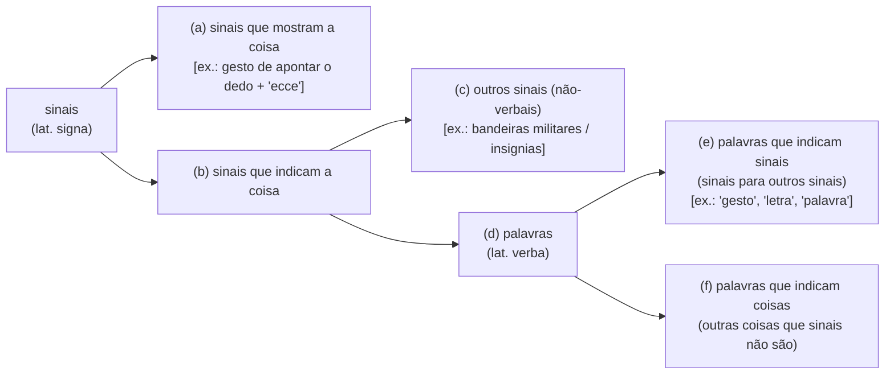
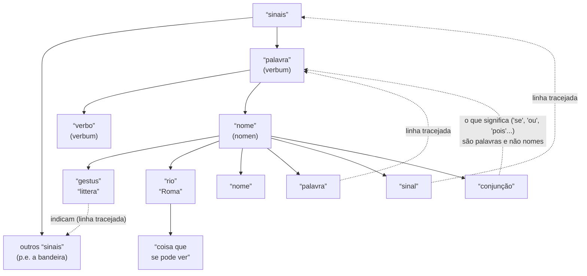

# Resumo Acadêmico e Fichamento Exaustivo: *Agostinho: De Magistro – Uma Análise sob o Aspecto da Filosofia da Linguagem* (Gisela Anna Büttner Lermen)

> **Contrato Epistemológico de Leitura e Rastreabilidade:**  
> Este documento segue rigorosamente a separação entre camadas textuais. Todas as informações contêm localização tripla quando aplicável: **página impressa do artigo (pp. 24–34)**, **página do arquivo PDF (pp. 1–11)** e **referência canônica ao *De Magistro* (DM) e às páginas da edição *Os Pensadores* ou de *Coseriu (1975)*** conforme as 54 notas finais do artigo. As afirmações são classificadas, quando necessário para evitar ambiguidade, em:
> - **[Explícito no texto]**: formulado literalmente pela autora do artigo (ou nas passagens de Agostinho e Coseriu por ela citadas).
> - **[Inferido com alta segurança]**: reconstruído diretamente a partir da estrutura argumentativa e das passagens explícitas do artigo.
> - **[Interpretação/Observação analítica]**: comentário técnico ou síntese metodológica claramente separado da voz de Gisela Anna Büttner Lermen.

---

## 1. Referência Bibliográfica e Metadados

- **Referência disponível no documento**: LERMEN, Gisela Anna Büttner. Agostinho: De Magistro – Uma análise sob o aspecto da Filosofia da Linguagem. [Periódico, local e ano de publicação: **não informados** nos cabeçalhos/rodapés do exemplar digitalizado; afiliação institucional declarada: Universidade Católica de Pernambuco — UNICAP], p. 24–34. *(Nota de datação bibliográfica: o artigo é posterior ou datado de **1975**, ano da publicação mais recente listada na Bibliografia final, p. 33; p. 10 do PDF).*
- **Autora**: Gisela Anna Büttner Lermen (Universidade Católica de Pernambuco).
- **Tipo de material**: Artigo acadêmico publicado em periódico filosófico/universitário (pp. 24–34; pp. 1–11 do PDF).
- **Idioma original**: Português (com termos técnicos citados em latim, alemão e grego antigo).
- **Área do conhecimento**: Filosofia / Filosofia da Linguagem / História da Filosofia da Linguagem / Semiótica.
- **Palavras-chave**: **Não informadas** (o artigo inicia diretamente na seção *INTRODUÇÃO*, sem *Resumo/Abstract* ou *Palavras-chave* formais impressos na página 24; p. 1 do PDF).
- **Classificação metodológica**: Estudo teórico-exegético e crítico-historiográfico em Filosofia da Linguagem.
- **Corpus primário e base teórica declarados pela autora [Explícito no texto, p. 24 e p. 33; pp. 1 e 10 do PDF]**:
  1. **Obra primária**: SANTO AGOSTINHO. *De Magistro (Do Mestre)*. Coleção "Os Pensadores", vol. VI. São Paulo: Abril Cultural, 1973, pp. 319–356 (citado nas notas como `DM` e `Pensadores`).
  2. **Obra teórica de referência principal**: COSERIU, Eugenio. *Die Geschichte der Sprachphilosophie von der Antike bis zur Gegenwart. Eine Übersicht, Teil I: Von der Antike bis Leibniz*. Tübingen: Gunter Narr Verlag, 1975 (preleções ministradas durante o semestre de inverno de 1968/69 na Universidade de Tübingen, especificamente pp. 126–137).
- **Extensão do documento**: 11 páginas no arquivo PDF (numeradas de p. 24 a p. 34 na paginação original impressa, contendo Introdução, 4 seções numeradas, 2 diagramas arbóreos, Bibliografia e 54 notas finais).

---

## 2. Síntese Executiva dos Eixos da Pesquisa (Problema, Objetivos, Referencial, Metodologia e Resultados)

### 2.1. Problema de Pesquisa
- **[Explícito no texto, pp. 24–25; pp. 1–2 do PDF]**: Embora existam inúmeras interpretações do diálogo *De Magistro* (escrito por Agostinho em 389, ano da morte de seu filho e interlocutor Adeodato, então com 18 anos, em Cartago), quase todas concentram-se exclusivamente na doutrina pedagógica agostiniana, equiparando-a à teoria da reminiscência de Platão no diálogo *Mênon*. Diante dessa redução historiográfica, o problema central do artigo consiste em investigar o *De Magistro* sob o aspecto específico da **Filosofia da Linguagem**: partindo da natureza e classificação dos sinais (*signa*), como Agostinho equaciona a relação entre linguagem e metalinguagem e a possibilidade mesma de ensinar e aprender por meio das palavras (*docere* / *discere*), e quais são tanto os paralogismos quanto as intuições fecundas dessa análise para a teoria da linguagem?

### 2.2. Objetivos
- **Objetivo Geral [Explícito no texto, pp. 24–25; pp. 1–2 do PDF]**: Analisar o diálogo *De Magistro* de Santo Agostinho sob a perspectiva da Filosofia da Linguagem, apoiando-se na leitura histórico-crítica desenvolvida por Eugenio Coseriu em suas preleções de Tübingen (1968/69, publicadas em 1975), para demonstrar que a obra contém: **(1)** a semiótica mais pormenorizada da Antiguidade; **(2)** princípios básicos da distinção entre "linguagem" e "metalinguagem"; e **(3)** uma nova colocação do problema do valor cognitivo da língua em relação à teoria do conhecimento.
- **Objetivos Específicos [Explícito no texto, pp. 24–25; pp. 1–2 do PDF]**:
  1. Examinar o problema dos sinais (*signa*) em geral e reconstruir sua classificação semiótica a partir do diálogo agostiniano (Seção 1, pp. 25–26; pp. 2–3 do PDF).
  2. Apresentar os princípios da distinção entre "linguagem" e "metalinguagem" nos capítulos IV a VIII do *De Magistro*, contrastando o tratamento agostiniano com a dupla distinção de Coseriu entre *"metalinguagem linguística"* (*sprachliche Metasprache*) e *"metalinguagem do discurso"* (*Metasprache der Rede*) (Seção 2, pp. 26–29; pp. 3–6 do PDF).
  3. Analisar o tema central da segunda parte do diálogo (capítulos IX a XIV): a questão de saber se se aprende alguma coisa por meio das palavras, incluindo o estatuto das narrativas históricas, as cinco insuficiências das palavras e a tese da verdade interior / Mestre Interior (Seção 3, pp. 29–31; pp. 6–8 do PDF).
  4. Expor a avaliação crítica de Eugenio Coseriu sobre o diálogo agostiniano, dividida em duas vertentes: primeiro, uma **crítica negativa** que identifica 8 paralogismos e limites teóricos no argumento de Agostinho; segundo, uma **avaliação positiva** que destaca 3 "intuições profundas" de Agostinho para a Filosofia da Linguagem (Seção 4, pp. 31–33; pp. 8–10 do PDF).

### 2.3. Referencial Teórico
- **[Explícito no texto, pp. 24, 33–34; pp. 1, 10–11 do PDF]**:
  - **Eugenio Coseriu (1968/69; 1975)**: *Die Geschichte der Sprachphilosophie von der Antike bis zur Gegenwart. Eine Übersicht, Teil I: Von der Antike bis Leibniz* (Tübingen: Gunter Narr Verlag, 1975, pp. 126–137). Fornece todo o arcabouço analítico, classificatório e crítico do artigo: os esquemas arbóreos da semiótica e da metalinguagem agostinianas, a distinção teórica entre *sprachliche Metasprache* e *Metasprache der Rede*, a identificação do germe da teoria moderna dos nomes próprios sem conotação/intensão e o balanço crítico final (os 8 pontos negativos e os 3 pontos positivos).
  - **Santo Agostinho (389 d.C. / ed. 1973)**: *De Magistro (Do Mestre)*, citado na versão portuguesa da Coleção "Os Pensadores", vol. VI (São Paulo: Abril Cultural, 1973, pp. 319–356), percorrendo sistematicamente os capítulos I a XIV (46 parágrafos) e articulando a citação bíblica paulina de *2 Coríntios* 1,19 (Nota 30, p. 34; p. 11 do PDF) e o relato veterotestamentário dos três jovens na fornalha em *Daniel* (DM XI 37, p. 29; p. 6 do PDF).
  - **Platão**: Diálogo *Mênon* e o conceito platônico de reminiscência (*ἀνάμνησις* / *anámnēsis*), mobilizados na Introdução (p. 24) e no terceiro ponto positivo da Avaliação Crítica (p. 33; p. 10 do PDF).
  - **Tradição Lógica Escolástica Medieval**: O conceito posterior de ***suppositio formalis*** (suposição formal), invocado na página 29 (p. 6 do PDF) para nomear a regra agostiniana (DM VIII 22–24) de que, no uso normal da fala, as palavras são tomadas em relação às coisas extralinguísticas que significam e não em relação a si mesmas.
  - **Estudos anteriores registrados nas Notas, porém explicitamente declarados como não consultados diretamente pela autora (p. 24 e Nota 2, p. 33; pp. 1 e 10 do PDF)**:
    1. BARWICK, K. *Probleme der stoischen Sprachlehre und Rhetorik*. Berlin, 1957.
    2. KUYPERS, K. *Der Zeichen- und Wortbegriff im Denken Augustins*. Amsterdam, 1934.
    3. OTTO, W. *Über die Schrift des heiligen Augustinus "De Magistro"*. Hechingen, 1908.

### 2.4. Metodologia
- **[Explícito no texto / Inferido com alta segurança, pp. 24–25; pp. 1–2 do PDF]**:
  - **Abordagem**: Análise exegético-estrutural do diálogo *De Magistro* guiada pela grade teórico-crítica da história da filosofia da linguagem de Eugenio Coseriu.
  - **Procedimento em 4 etapas (explicitado no plano da Introdução, pp. 24–25; pp. 1–2 do PDF)**:
    1. **Reconstrução taxionômica e diagramática da semiótica agostiniana (Seção 1)**: mapeamento das formas de ensinar (*ostendere*, *agere*, *significare*), sistematização em árvore dicotômica das seis categorias de sinais `(a)` a `(f)` e extração da hierarquia axiológica entre *coisa*, *sinal* e *conhecimento*.
    2. **Análise lógica e metalinguística (Seção 2)**: aplicação da distinção coseriana entre *metalinguagem linguística* e *metalinguagem do discurso* aos capítulos IV–VIII do *De Magistro*, com modelagem gráfica das relações de inclusão, reciprocidade e autorreferência entre *signum*, *verbum* (palavra e verbo), *nomen*, *gestus*, *littera* e *conjunção*.
    3. **Reconstrução do argumento epistemológico sobre o ensino verbal (Seção 3)**: acompanhamento analítico da segunda parte do diálogo (caps. IX–XIV), isolando o caso das palavras isoladas (*"cabeça"*), o caso das palavras em narrativa histórica (*três jovens nas chamas*, distinção entre *acreditar* e *saber*), a lista numerada das 5 insuficiências comunicativas das palavras e a conclusão iluminista do Mestre Interior (Cristo).
    4. **Balanço crítico bifronte (Seção 4)**: avaliação sistemática em duas listas numeradas — 8 críticas negativas (paralogismos semânticos e deslocamentos de nível cometidos por Agostinho) e 3 contribuições positivas duradouras ("intuições profundas" de Agostinho para a filosofia da linguagem).
  - **Transparência documental**: A autora declara explicitamente na Introdução (p. 24; p. 1 do PDF) as limitações materiais de sua pesquisa: a impossibilidade de acessar os três estudos europeus citados por Coseriu e a ausência do texto original em latim do *De Magistro*, trabalhando sobre a tradução portuguesa de 1973 e reconstruindo os termos latinos e gregos essenciais nos pontos-chave.

### 2.5. Resultados Principais
- **[Explícito no texto, pp. 24–33; pp. 1–10 do PDF]**:
  1. **Esboço da semiótica mais detalhada da Antiguidade**: A classificação dos sinais em *sinais que mostram a coisa* (como apontar o dedo) e *sinais que indicam a coisa* (subdivididos em *outros sinais não-verbais*, como bandeiras militares, e *palavras*, que por sua vez indicam *outros sinais* ou *coisas que não são sinais*), aliada à distinção axiológica entre coisa, sinal e conhecimento, constitui um sistema semiótico sem precedentes na Antiguidade.
  2. **Descoberta pioneira, porém incompleta, da metalinguagem**: Agostinho formula princípios fundamentais da distinção entre linguagem e metalinguagem (incluindo sinais reflexivos, sinais recíprocos de valor desigual, igual ou idêntico, e a regra normal da referência objetual, precursora da *suppositio formalis*), mas **não distingue** entre *metalinguagem linguística* (termos que nomeiam classes gramaticais, como `"nome"` enquanto conceito que abrange `"rio"` e `"homem"`) e *metalinguagem do discurso* (qualquer palavra tomada autonomamente como objeto do discurso, como `"nome"`, `"quis"` ou `"sim"` nomeando a si mesma). Essa confusão leva Agostinho a demonstrar falaciosamente que toda palavra é um nome.
  3. **Início da teoria moderna dos nomes próprios e distinção entre texto e lista de palavras**: Na análise da narrativa bíblica dos três jovens na fornalha (DM XI 37), a observação de Agostinho de que os nomes próprios dos jovens nada ajudam a conhecê-los inaugura a teoria posterior dos **nomes próprios como termos desprovidos de "intensão", "conotação" ou significado conceitual** (Coseriu, p. 137). Além disso, sua distinção entre *acreditar* e *saber* diante do relato implica que uma narração não se reduz a uma lista de palavras.
  4. **Diagnóstico dos 8 paralogismos agostinianos**: A tese radical de que "nada se aprende por meio das palavras" decorre, do ponto de vista filosófico-linguístico, de oito falhas argumentativas identificadas por Coseriu: (1) equivocidade do verbo *docere* em três sentidos distintos; (2) extrapolação indevida da aquisição ostensiva inicial para toda a linguagem; (3) exigência impossível de experimentar a coisa pelo próprio nome isolado (refutada pelo exemplo do *"elefante"*, conhecido por descrições e definições); (4) redução da palavra a sinal sonoro vazio, em vez de `sinal + significado`; (5) confusão entre o significado de uma frase/texto e a soma das palavras isoladas; (6) negação da função sociocultural e histórica da linguagem como transmissora de *experiência indireta*; (7) mistura entre insuficiências contingentes da comunicação e o nível próprio da língua; e (8) passagem para um *a priori teológico* (Cristo como Mestre Interior).
  5. **Reconhecimento de 3 intuições filosófico-linguísticas profundas**: Apesar dos paralogismos, Agostinho estabelece três conquistas fundamentais: (1) a apreensão mesma de um sinal (`Sinal + significado`) já repousa numa **intuição** que ultrapassa a situação física imediata e o condicionamento atual (como mostra a objeção de Adeodato sobre ensinar *"andar"* caminhando); (2) a **subjetividade dos significados** na consciência individual e a impossibilidade teórica de experienciar diretamente a consciência do outro; e (3) o **caráter essencialmente criativo do aprender**, pois os critérios da verdade já residem no interior do sujeito que julga ativamente cada comunicação.

---

## 3. Conceitos Centrais e Definições Operacionais

| Conceito / Termo Técnico | Origem / Citação no Artigo | Definição e Papel no Argumento de Lermen / Coseriu | Localização e Grau de Explicitação |
| :--- | :--- | :--- | :--- |
| ***Ostendere*, *Agere* e *Significare*** | Agostinho (DM III 5,6) | As três maneiras analisadas para ensinar as coisas: **mostrá-las** diretamente (*ostendere*, ex.: corpos presentes), **fazê-las** na prática (*agere*, ex.: andar, comer, beber, gritar no momento da ação) e **indicá-las por sinais** (*significare*, indispensável quando a coisa não pode ser mostrada). | p. 25, Nota 4 (p. 2 do PDF) — **Definido explicitamente** |
| **Sinal (*lat. signum*)** | Agostinho (DM IV 9) | *"Chamamos sinais a tudo o que significa algo, e entre estes encontramos também as palavras"* (inclui gestos, letras escritas, bandeiras militares/*insignias* e palavras faladas). É o gênero mais amplo: toda palavra é sinal, mas nem todo sinal é palavra. | pp. 25–27, Notas 6, 20–21 (pp. 2–4 do PDF) — **Definido explicitamente** |
| **Metalinguagem linguística (*sprachliche Metasprache*)** | Eugenio Coseriu (1975, p. 129) | Primeiro tipo de metalinguagem: abrange todas as palavras do léxico que indicam a realidade da própria língua enquanto conceitos ou classes (ex.: *"língua"*, *"palavra"*, *"verbo"*, *"nome"*, *"discurso"*, *"conjunção"*). Aqui, *"nome"* designa uma classe à qual pertencem *"rio"*, *"homem"* e `"nome"`. | pp. 26–28, Notas 12, 15 (pp. 3–5 do PDF) — **Definido explicitamente** |
| **Metalinguagem do discurso (*Metasprache der Rede*)** | Eugenio Coseriu (1975, p. 129) | Segundo tipo de metalinguagem: ocorre quando qualquer elemento linguístico (inclusive termos como *"rio"*, *"homem"*, *"virtude"*, *"quis"*, *"volo"*, *"bene"*, *"sim"*) é tomado no discurso não para indicar a realidade extralinguística, mas como coisa/objeto indicado (cada palavra funcionando como o seu próprio nome). | pp. 26–28, Nota 13 (pp. 3–5 do PDF) — **Definido explicitamente** |
| **Palavra (*verbum*) vs. Verbo (*verbum*)** | Agostinho (DM IV 9) | Dupla acepção do latim *verbum*: (1) em sentido geral, **"palavra"** (classe que inclui nomes, verbos, conjunções etc.); (2) em sentido gramatical estrito, **"verbo"**, *"aquela parte do discurso que se declina por tempos, como 'escrevo', 'escrevi', 'leio', 'li', que manifestamente não são nomes"*. | p. 27, Notas 17–19 (p. 4 do PDF) — **Definido explicitamente** |
| **Sinais recíprocos e Sinais que significam a si mesmos** | Agostinho (DM VII 20) | **Sinais que significam a si mesmos**: termos como `"sinal"`, `"palavra"` e `"nome"`, que pertencem à própria classe que designam. **Sinais recíprocos**: termos que se designam mutuamente, classificados em três níveis: (1) *valor desigual* (`"sinal"` vale mais/denota mais coisas que `"palavra"`); (2) *valor igual* (`"palavra"` em geral e `"nome"` em geral); (3) *idênticos* (diferenciando-se só pelo som: latim `'nomen'` e grego `'ὄνομα'`). | p. 28, Notas 25–29 (p. 5 do PDF) — **Definido explicitamente** |
| ***Suppositio formalis* (Suposição formal)** | Tradição escolástica / Agostinho (DM VIII 22, 24) | A suposição habitual que fazemos ao falar de que as palavras não se relacionam consigo mesmas (como sinais/sílabas), mas sim com outra coisa (a realidade significada, ex.: `"homem"` tomado como *animal* e não como *nome* dissílabo). | p. 29 (p. 6 do PDF) — **Definido explicitamente** |
| **Nomes próprios sem "intensão" ou "conotação"** | Coseriu (1975, p. 137) a partir de Agostinho (DM XI 37) | Começo da teoria moderna dos nomes próprios identificado na observação de Agostinho sobre os três jovens na fornalha: os nomes próprios dos jovens não possuem conteúdo conceitual descritivo ("intensão", "conotação" ou "significado") capaz de dar a conhecer os indivíduos se estes não forem conhecidos por experiência. | p. 29, Notas 41–42 (p. 6 do PDF) — **Definido explicitamente** |
| **Acreditar (*credere*) vs. Saber (*scire*) / Aprender** | Agostinho (DM XI 37) | Distinção epistemológica central: diante de uma narração histórica (como a dos três jovens na fornalha), pode-se *acreditar* que os fatos ocorreram como escritos, mas não *saber* por experiência/visão mental direta; como *aprender* em sentido estrito inclui *saber*, Agostinho nega que se aprenda pela narração. | pp. 29–30, Nota 43 (pp. 6–7 do PDF) — **Definido explicitamente** |
| **Os três sentidos de *Docere* (Ensinar)** | Eugenio Coseriu (Avaliação Crítica, ponto 1) | Tripla acepção que o verbo-chave *docere* assume ao longo do *De Magistro* sem que Agostinho os diferencie claramente: **(1)** comunicar o que se pensa; **(2)** transmitir a experiência direta; **(3)** comunicar o que é verdadeiro. | pp. 31–32 (pp. 8–9 do PDF) — **Definido explicitamente** |
| **Verdade Interior / Mestre Interior (*A priori* teológico)** | Agostinho (DM XI 38; XIV 45–46) / Coseriu (Avaliação Crítica, ponto 8 e ponto positivo 3) | Para Agostinho, a verdade que preside interiormente à própria mente (identificada teologicamente com Cristo), à qual as palavras exteriores apenas incitam o ouvinte a recorrer. Na leitura de Coseriu, sob o ângulo estrito da filosofia da linguagem, a identificação com Cristo é o ***a priori* teológico** de Agostinho, enquanto epistemologicamente corresponde ao caráter intuitivo e criativo do aprender (análogo à *ἀνάμνησις* no *Mênon* de Platão). | pp. 30–33, Notas 44, 51–52 (pp. 7–10 do PDF) — **Definido explicitamente** |

---

## 4. Elementos Visuais e Diagramas Reconstruídos

O artigo de Gisela Anna Büttner Lermen contém **dois diagramas arbóreos fundamentais** (nas páginas 25 e 27; páginas 2 e 4 do PDF), ambos elaborados a partir das preleções de Eugenio Coseriu para formalizar a semiótica e a metalinguagem do *De Magistro*.

### 4.1. Esquema 1: Classificação Semiótica dos Sinais segundo Coseriu (p. 25 do texto; p. 2 do PDF)
- **Localização**: Seção `1. O PROBLEMA DOS SINAIS`, p. 25 (p. 2 do PDF).
- **Função no argumento**: Demonstrar que da divisão agostiniana das funções sígnicas resulta *"o esboço de uma semiótica"* (p. 25).

- **Análise detalhada das categorias do Esquema 1 (pp. 25–26; pp. 2–3 do PDF)**:
  - **Categoria `(a)`**: Exemplificada pelo gesto de apontar o dedo (frequentemente acompanhado do advérbio *'ecce'*, "eis"). Agostinho atribui-lhe pouca importância porque *"é mais o sinal do ato de indicar do que das próprias coisas indicadas"* (DM X 34, Nota 5).
  - **Categoria `(c)`**: Sinais indicativos não-verbais, como as bandeiras militares (*insignias*), que Agostinho afirma serem *"sinais em sentido próprio, coisa que não se poderia dizer das palavras"* (DM IV 9, Nota 6).
  - **Categoria `(d)` subdividida em `(e)` e `(f)`**: As palavras (*verba*) exercem dupla função: em `(e)`, significam as próprias palavras ou outros sinais (como os vocábulos `'gesto'` e `'letra'`, sendo as letras escritas *"sinais de sinais, quer dizer, sinais dos sons articulados pela voz"*, DM IV 7–8, Notas 7–8); em `(f)`, indicam coisas extralinguísticas que não são sinais (DM VII 20; IV 8, Nota 9).

### 4.2. Esquema 2: Rede de Relações da "Metalinguagem Linguística" (p. 27 do texto; p. 4 do PDF)
- **Localização**: Seção `2. DISTINÇÃO "LINGUAGEM" – "METALINGUAGEM"`, p. 27 (p. 4 do PDF; inspirado em Coseriu, 1975, p. 130, Nota 15).
- **Função no argumento**: Visualizar as relações de subordinação de classes, extensão e reflexividade entre `"sinais"`, `outros "sinais"`, `"palavra" (verbum)`, `"verbo" (verbum)` e `"nome" (nomen)` nos capítulos IV a VI do *De Magistro*.

- **Análise detalhada das relações do Esquema 2 (pp. 27–28; pp. 4–5 do PDF)**:
  - **Linhas contínuas descendentes**: representam a inclusão de elementos ou subclasses dentro de uma classe superior (`"sinais"` inclui `outros "sinais"` e `"palavra"`; `"palavra"` inclui `"verbo"` e `"nome"`; a classe `"nome"` inclui `"gestus"`, `"littera"`, `"rio"`, `"Roma"`, `"nome"`, `"palavra"`, `"sinal"` e `"conjunção"`).
  - **Seta vertical inferior (`"rio" / "Roma"` -> `"coisa que se pode ver"`)**: representa os nomes da linguagem-objeto que indicam coisas visíveis/extralinguísticas (como Rômulo, Roma, virtude, rio — DM IV 8, Nota 23).
  - **Linhas tracejadas ascendentes**: mostram para qual domínio aponta aquilo que é *significado* por certos nomes metalinguísticos:
    1. `"gestus"` e `"littera"` pertencem à classe gramatical dos `"nomes"`, mas *aquilo que eles indicam* (o gesto físico ou a letra escrita) não são nomes nem palavras, e sim `outros "sinais"`.
    2. `"conjunção"` pertence à classe dos `"nomes"`, mas *aquilo que ela significa* (*"se"*, *"ou"*, *"pois"*, *"se não"*, *"logo"*, *"porque"*, DM V 11, Nota 24) não são nomes, mas sim `"palavras"`.
    3. `"palavra"` e `"sinal"` pertencem à classe dos `"nomes"`, enquanto seus significados remetem às classes superiores `"palavra" (verbum)` e `"sinais"`.

---

## 5. Argumentos Principais e Reconstrução Exaustiva por Seções

### INTRODUÇÃO (pp. 24–25 do texto; pp. 1–2 do PDF)

1. **Superação da leitura meramente pedagógico-platônica do *De Magistro***
Escrito em **389** (ano do falecimento em Cartago de seu interlocutor e filho **Adeodato**, de **18 anos**), o *De Magistro* foi tradicionalmente reduzido pelos comentadores a um tratado pedagógico equivalente ao *Mênon* de Platão. Lermen sustenta que Agostinho visa, na verdade, a uma questão propriamente filosófico-linguística: *"partindo dos sinais, ele coloca a questão acerca da maneira e da possibilidade mesma de ensinar aos homens por meio das palavras"* (p. 24; p. 1 do PDF).

2. **Tríplice relevância da obra para a Filosofia da Linguagem e base em Eugenio Coseriu**
O diálogo agostiniano encerra três contribuições capitais: **(1)** *"a semiótica mais pormenorizada da Antigüidade"*; **(2)** *"princípios básicos da distinção entre 'linguagem' e 'metalinguagem'"*; e **(3)** *"uma nova colocação do problema do valor da língua em relação à teoria do conhecimento"* (p. 24; p. 1 do PDF). Diante da escassez de estudos na área, o artigo apoia-se nas preleções de **Eugenio Coseriu** do semestre de inverno de **1968/69** em Tübingen (publicadas em 1975), registrando com transparência que três obras anteriores citadas por Coseriu (Barwick 1957, Kuypers 1934 e Otto 1908) e o original latino do diálogo não puderam ser consultados, utilizando-se a tradução brasileira de *Os Pensadores* (1973).

---

### 1. O PROBLEMA DOS SINAIS (pp. 25–26 do texto; pp. 2–3 do PDF)

1. **Limites da ostensão direta (*ostendere*) e da execução de ações (*agere*)**
Embora se possa ensinar coisas mostrando-as (*lat. ostendere*), fazendo-as (*agere*) ou indicando-as por sinais (*significare*), é impossível mostrar diretamente todas as coisas — seja porque corpos não estão presentes, seja porque certas qualidades ou atividades (como comer, beber, gritar, andar) não estão sendo realizadas no exato momento da pergunta (DM III 5,6, Nota 4). Daí a necessidade absoluta dos sinais indicativos (p. 25; p. 2 do PDF).

2. **A classificação semiótica em seis níveis e a crítica ao gesto ostensivo**
Sistematizando o diálogo, Coseriu divide os sinais (*lat. signa*) em **(a) sinais que mostram a coisa** e **(b) sinais que indicam a coisa**. Quanto a `(a)`, como o gesto de apontar o dedo acompanhando o advérbio *'ecce'* ("eis"), Agostinho desvaloriza sua capacidade de mostrar a coisa em si, pois o dedo apontado *"é mais o sinal do ato de indicar do que das próprias coisas indicadas"* (DM X 34, pp. 25–26; pp. 2–3 do PDF). Já os sinais que indicam a coisa `(b)` dividem-se em **(c) outros sinais não-verbais** — como as bandeiras militares (*insignias*), consideradas sinais em sentido próprio (DM IV 9) — e **(d) palavras (*lat. verba*)**, que cumprem dupla função: **(e) palavras que indicam sinais** (como `'gesto'` e `'letra'`, sendo as letras escritas *"sinais de sinais, quer dizer, sinais dos sons articulados pela voz"*, DM IV 7–8) e **(f) palavras que indicam coisas que não são sinais** (DM VII 20; IV 8).

3. **A hierarquia axiológica entre coisa, sinal e conhecimento (DM IX 25–26)**
Agostinho estabelece uma separação rigorosa de valor entre **coisa**, **sinal** e **conhecimento** (p. 26; p. 3 do PDF):
   - A coisa significada é superior ao sinal, pois *"tudo o que existe devido a outra coisa, necessariamente tem valor menor que a coisa pela qual existe"* (DM IX 25, Nota 10);
   - O conhecimento é superior ao sinal, *"senão porque este existe devido àquele e não aquele por causa deste"* (DM IX 26, Nota 11).

---

### 2. DISTINÇÃO "LINGUAGEM" – "METALINGUAGEM" (pp. 26–29 do texto; pp. 3–6 do PDF)

1. **A dupla distinção teórica de Coseriu e o ponto cego de Agostinho**
Lermen expõe a tese central de Coseriu (1975, pp. 126–129, Notas 12–14) sobre a natureza dupla da metalinguagem (pp. 26–27; pp. 3–4 do PDF):
   - **Metalinguagem linguística (*sprachliche Metasprache*)**: conjunto das palavras do léxico que designam realidades e categorias da própria língua enquanto conceitos ou classes (ex.: *"língua"*, *"palavra"*, *"verbo"*, *"nome"*, *"discurso"*). Nesse plano, a palavra `"nome"` significa uma **classe** à qual pertencem `"rio"`, `"homem"` e a própria palavra `"nome"`.
   - **Metalinguagem do discurso (*Metasprache der Rede*)**: uso discursivo em que qualquer elemento linguístico (tanto `"rio"`, `"homem"`, `"virtude"` quanto `"língua"`, `"palavra"`, `"nome"`) deixa de pertencer à realidade que indica e passa a ser a realidade indicada — isto é, a palavra tomada individualmente como **coisa** (a palavra `"nome"` como tal).
   **Diagnóstico crítico**: *"Agostinho não vê esta dupla distinção. Ao contrário, trata dos dois tipos de metalinguagem sem diferenciá-los. Coseriu, por causa disso, só alude a 'princípios', se bem que 'princípios importantes', da distinção entre linguagem e metalinguagem contidos na obra de Agostinho"* (p. 26; p. 3 do PDF).

2. **Hierarquia lógica de inclusão entre *signum*, *verbum* e *nomen* (Capítulos IV–VI)**
Ao analisar os sinais que se mostram por sinais (DM IV 7–9, Notas 16–22), Agostinho estabelece relações lógicas de inclusão assimétrica entre classes (p. 27; p. 4 do PDF):
   - *"todos os nomes são palavras, mas nem todas as palavras são nomes"* (DM IV 9, Nota 18); além do `"nome"` (*nomen*), pertence à classe das palavras o `"verbo"` (*verbum* em sentido estrito, parte do discurso declinada por tempos como `'escrevo'`, `'escrevi'`, `'leio'`, `'li'*, DM IV 9, Nota 19);
   - *"toda palavra é sinal, mas nem todo sinal é palavra"* (DM IV 9, Nota 21);
   - Para ambas as relações, Agostinho emprega a mesma analogia lógica de gênero e espécie: *"Todo cavalo é animal, mas nem todo animal é cavalo"* (DM IV 9, Nota 22).

3. **Sinais que significam a si mesmos e a classificação tripla dos sinais recíprocos (DM VII 20)**
A partir da composição da classe dos nomes (que abrange nomes de coisas como *Rômulo, Roma, virtude, rio*, além dos termos metalinguísticos `"nome"`, `"palavra"`, `"sinal"`, `"conjunção"`, `"gestus"` e `"littera"`, p. 28; p. 5 do PDF), Agostinho distingue os sinais que significam a si mesmos e divide os **sinais recíprocos** em três categorias (DM VII 20, Notas 25–29):
   1. **Sinais recíprocos que não têm o mesmo valor**: ex.: `"sinal"` e `"palavra"`, pois *"'sinal' vale mais que 'palavra', porque aquelas duas sílabas (sinal) denotam mais coisas que estas (palavra)"* (DM VII 20, Nota 26).
   2. **Sinais recíprocos que têm o mesmo valor**: ex.: `"palavra"` em geral e `"nome"` em geral (DM VII 20, Nota 27). **Crítica de Coseriu/Lermen**: na demonstração dessa equivalência (DM V 14–15, Nota 28), Agostinho confunde *metalinguagem linguística* e *metalinguagem do discurso*.
   3. **Sinais recíprocos completamente idênticos**: diferenciam-se apenas pelo som, como o latim `'nomen'` e o grego `'ὄνομα'` (DM VII 20, Nota 29).

4. **A substantivação discursiva em *2Cor* 1,19, a tradução latim-grego e a *suppositio formalis* (pp. 28–29; pp. 5–6 do PDF)**
Para provar que toda palavra pode ser o seu próprio nome (no plano que Coseriu chama de *metalinguagem do discurso*), Agostinho invoca:
   - A passagem de São Paulo (*2Cor* 1,19; DM V 14, Notas 30–31): *"Não havia em Cristo o sim e o não, mas só havia nele o sim"*, argumentando que `'est'` ("é / sim") funciona aí como um nome (não as três letras em si, mas o que com elas se significa quando nomeado por `'est'`).
   - O argumento interlinguístico latim-grego (DM V 15, Nota 32): se perguntarmos como os gregos nomeiam o que nós nomeamos `'quis'` (quem), responde-se `'τίς'`; para `'volo'` (quero), `'θέλω'`; para `'bene'` (bem), `'καλῶς'`. Para Coseriu, esse exemplo fundamenta a observação gramatical de que **todas as palavras usadas na metalinguagem do discurso funcionam como substantivos** (p. 28; p. 5 do PDF).
   - O paradoxo *"Dize-me se 'homem é homem'... Pergunto se és por acaso estas duas sílabas unidas..."* (DM VIII 22, 24, Notas 33–34): Agostinho conclui que `'homem'` é tanto `'nome'` (enquanto sinal / parte da oração) quanto `'animal'` (enquanto indica a coisa significada), mas ressalta que, na comunicação normal, supõe-se sempre que as palavras se referem às coisas e não a si mesmas — regra que a lógica medieval batizará de ***suppositio formalis*** (pp. 28–29; pp. 5–6 do PDF).

---

### 3. SE SE APRENDE POR MEIO DAS PALAVRAS (pp. 29–31 do texto; pp. 6–8 do PDF)

1. **A primazia da experiência da coisa sobre o sinal: o exemplo de *"cabeça"* (DM IX 27 – X 34)**
Retomando a pergunta inicial (*"quando falamos queremos ensinar; porém, como aprender?"*, DM I 1, Nota 35), Agostinho estabelece que o conhecimento das coisas significadas é mais precioso que os sinais (DM IX 27, Nota 36). Contra a insistência de Adeodato de que nada se ensina sem sinais (DM X 29, Nota 37), Agostinho analisa como alguém aprende a palavra desconhecida *"cabeça"* (DM X 34, Notas 38–39) e inverte a relação entre palavra e coisa: *"não aprendemos nada por meio desses sinais que chamamos palavras: antes... aprendemos o valor da palavra, ou seja, o significado que está escondido no som através do conhecimento ou da própria percepção da coisa significada, mas não a própria coisa através do significado"* (p. 29; p. 6 do PDF).

2. **O caso das narrativas históricas: os três jovens nas chamas, os nomes próprios sem conotação e *acreditar* vs. *saber* (DM XI 37)**
Diante do caso em que as palavras aparecem articuladas numa história — o relato bíblico dos três jovens na fornalha ardente (DM XI 37, Notas 40–43, pp. 29–30; pp. 6–7 do PDF) — Agostinho desenvolve três teses fundamentais:
   - **Conhecimento prévio dos conceitos gerais**: *"Todas as coisas significadas por aquelas palavras já eram de nosso conhecimento"* (o que significam *"três jovens"*, *"forno"*, *"fogo"*, *"rei"*, *"ser preservado do fogo"*).
   - **Incapacidade cognitiva dos nomes próprios (antecipação da semântica moderna)**: A única coisa desconhecida diretamente são os próprios jovens singulares, mas *"nem os seus nomes... ajudaram ou poderiam ajudar a conhecê-los"* (DM XI 37, Nota 41). Lermen destaca, com Coseriu (1975, p. 137, Nota 42), que **encontra-se aqui o começo da teoria moderna dos nomes próprios como nomes sem "intensão", sem "conotação", sem significado conceitual** (p. 29; p. 6 do PDF).
   - **Diferença entre *acreditar* e *saber***: Agostinho declara: *"Mais que saber, posso dizer acreditar que tudo aquilo que se lê naquela narração histórica aconteceu naquele tempo assim como foi escrito"* (DM XI 37, Nota 43). Como *aprender* em sentido estrito exige *saber* (e não mero *acreditar*), não se aprende pela narração — do que se segue implicitamente, observa Lermen, que *"a narração não se equipara a uma lista de palavras"* (p. 30; p. 7 do PDF).

3. **A consulta à verdade interior (DM XI 38 – XII 40)**
Agostinho formula sua conclusão geral: quem ouve palavras ou ignora se são verdadeiras (crê, opina ou duvida), ou sabe que são falsas e as nega, ou sabe que são verdadeiras e as afirma — mas em nenhum dos três casos aprende pelas palavras ouvidas, pois consulta não a voz exterior, *"mas a verdade que dentro dele preside à própria mente, talvez incitada pelas palavras ouvidas a consultá-la"* (DM XI 38; XII 40, Notas 44–45, p. 30; p. 7 do PDF).

4. **As cinco insuficiências das palavras quanto a manifestar o pensamento do falante (DM XIII 42–44)**
Agostinho acrescenta que *"nem sequer resta às palavras o ofício de, ao menos, manifestarem o pensamento de quem fala"* (DM XIII 42, Nota 46), elencando **5 insuficiências** (p. 30; p. 7 do PDF):
   1. **Incerteza sobre o saber do próprio falante**: *"É incerto se este sabe ou não o que diz"* (DM XIII 42, Nota 47), não sendo certo se as palavras representam o que ele pensa.
   2. **Mentira intencional**: pode-se mentir pelas palavras para enganar o outro.
   3. **Descompasso involuntário entre fala e pensamento**: nos exemplos do lapso da língua ou de um hino que se canta mecanicamente, diz-se ou canta-se uma coisa enquanto se pensa em outra.
   4. **Divergência semântica sobre as mesmas palavras**: quando interlocutores associam significados diferentes aos mesmos vocábulos, *"a controvérsia gira não em torno da coisa, senão da palavra"* (DM XIII 43, Nota 48); a definição ajudaria, mas segundo Agostinho há poucos bons definidores.
   5. **Deficiência auditiva/acústica**: disputas demoradas apenas porque não se ouviu bem o som (caso ao qual Agostinho atribui pouca importância diante da impossibilidade de conhecer o pensamento de quem fala mesmo ouvindo perfeitamente as palavras, DM XIII 44, Nota 49).

5. **O argumento final sobre os mestres humanos e Cristo como Mestre Interior (DM XIV 45–46)**
Mesmo que nenhuma dessas cinco insuficiências existisse, as palavras do mestre humano não garantiriam o ensino da verdade: ninguém é tão tolo que mande o filho à escola para aprender *"o que pensa o mestre"* (DM XIV 45, Nota 50), mas sim para aprender as disciplinas, a virtude e a sabedoria. Quando o mestre expõe as disciplinas, os discípulos julgam interiormente se as coisas ditas são verdadeiras contemplando segundo suas forças a **verdade interior** (DM XIV 45, Nota 51), cujo **Mestre Interior** é **Cristo** (DM XIV 46, Nota 52, p. 31; p. 8 do PDF).

---

### 4. AVALIAÇÃO CRÍTICA (pp. 31–33 do texto; pp. 8–10 do PDF)

Esta seção final sintetiza o balanço crítico de Eugenio Coseriu sobre o *De Magistro*, articulando **8 críticas negativas** e **3 contribuições positivas ("intuições profundas")**.

#### A) Crítica Negativa: Os 8 Paralogismos e Limites do *De Magistro* (pp. 31–32; pp. 8–9 do PDF)
1. **Polissemia não controlada do verbo-chave *"docere"* (ensinar)**: Ao longo do diálogo, *docere* assume três significados distintos sem que Agostinho os separe: **(a)** comunicar o que se pensa; **(b)** transmitir a experiência direta; **(c)** comunicar o que é verdadeiro. Quando o falante não tem certeza científica do que diz, Agostinho nega até mesmo que haja "comunicação do que se pensa", embora ocorra aí uma comunicação autêntica.
2. **Generalização falaciosa da experiência ostensiva inicial**: O fato de o aprendizado das *primeiras* palavras começar com a experiência direta das coisas sensíveis não implica que esse princípio valha para *todas* as coisas e *todos* os sinais da língua.
3. **Confusão entre aprender por palavras e experimentar a coisa pelo seu nome isolado (o exemplo do *"elefante"*)**: Agostinho pressupõe que aprender uma coisa pela palavra equivaleria a experimentá-la pelo seu nome isolado, o que é impossível. Coseriu refuta essa redução com um exemplo claro: *"Não se aprende por meio da palavra 'elefante' o que é um elefante, mas só pelas definições e descrições através de outras palavras"* (p. 31; p. 8 do PDF).
4. **Redução da palavra a sinal vazio**: Na segunda parte do diálogo, Agostinho interpreta as palavras apenas como sinais sonoros vazios, e não como a unidade **`sinal + significado`**, concluindo por isso que elas nada comunicam de novo sobre a coisa.
5. **Confusão entre o significado da frase/texto e o significado das palavras isoladas**: No exemplo bíblico dos três jovens na fornalha, Agostinho reduz o texto às palavras isoladas já conhecidas, esquecendo que *"consta, porém, a eficácia da linguagem exatamente na capacidade de exprimir coisas até então desconhecidas por meio de palavras conhecidas"* (p. 32; p. 9 do PDF).
6. **Negação do papel sociocultural e histórico da linguagem (*experiência indireta*)**: Ao perceber a força da narrativa e mudar o sentido de *docere* para "transmitir a experiência direta", Agostinho nega a função sociocultural mais decisiva da linguagem: proporcionar uma **experiência indireta das "coisas"**, graças à qual *"não é necessário que cada indivíduo humano construa toda a cultura desde o começo"* e sobre a qual se apoiam integralmente ciências como a **História** (p. 32; p. 9 do PDF).
7. **Deslocamento de nível nas insuficiências da comunicação**: As cinco insuficiências listadas por Agostinho (ignorância do falante, mentira, lapso/canto mecânico, homofonia, má audição) pertencem a outro nível da problemática linguística (psicológico, moral ou físico-acústico), distinto da questão epistemológica que o diálogo discute.
8. **Salto para o *"a priori teológico"***: Agostinho passa do caráter parcialmente intuitivo do aprender para o "Mestre Interior" identificado com Cristo. Do ponto de vista estrito da Filosofia da Linguagem, essa passagem *"parece absolutamente incompreensível"*; contudo, para Agostinho, o teológico não é uma dimensão entre outras, mas a dimensão fundamental — funcionando o Mestre Interior como o seu ***a priori* teológico** (p. 32; p. 9 do PDF).

#### B) Importância Positiva: As 3 "Intuições Profundas" de Agostinho segundo Coseriu (pp. 32–33; pp. 9–10 do PDF)
1. **Base intuitiva da própria apreensão do signo (`Sinal + significado`)**: Se encararmos o sinal como unidade `Sinal + significado`, o próprio ato de aprender um sinal já se fundamenta numa **intuição** que transcende a situação física imediata e o condicionamento atual. Coseriu destaca a aguda objeção de Adeodato sobre ensinar o significado de *"andar"* caminhando (DM X 29; X 32, Notas 53–54): *"Se a mim que parei de andar ou que estou fazendo outra coisa, alguém pergunta que é caminhar e eu, imediatamente, começando a caminhar, procurasse ensinar-lhe ou demonstrar-lhe isto sem sinal; como poderia evitar que ele acreditasse que caminhar é apenas o quanto andei?"* (p. 32; p. 9 do PDF).
2. **Subjetividade dos significados e inacessibilidade teórica da consciência alheia**: Agostinho observa com profundidade que cada falante opera sempre com seus próprios significados e jamais pode ter certeza absoluta de que são idênticos aos que estão na consciência do interlocutor: embora essa pressuposição funcione na prática comunicativa, *"teoricamente se tem que rejeitá-la, porque não temos nenhuma experiência do íntimo da consciência do outro"* (pp. 32–33; pp. 9–10 do PDF).
3. **O caráter essencialmente criativo do aprender**: Para Coseriu, a tese central do *De Magistro* exprime, no fundo, que **o aprender é um ato criativo**: os critérios da verdade já estão presentes no interior de cada ser humano, e é à luz deles que o aluno julga ativamente cada comunicação como aceitável, inaceitável ou duvidosa. Esse aprender brota da intuição que Agostinho chama de "Mestre Interior" e que coincide estruturalmente com a **reminiscência (*ἀνάμνησις*)** no *Mênon* de Platão: *"Em certo sentido, não se pode ensinar nada: os fundamentos, antes, já têm que estar colocados"* (p. 33; p. 10 do PDF).

---

## 6. Mapa do Argumento e Matriz de Alegações e Evidências

### 6.1. Caminho Argumentativo Global
1. **Reenquadramento disciplinar**: O *De Magistro* não é um mero tratado pedagógico platônico, mas uma investigação de Filosofia da Linguagem sobre a possibilidade de ensinar por sinais verbais.
2. **Construção da semiótica e da metalinguagem (1ª parte do diálogo)**: A necessidade de indicar o que não pode ser mostrado gera uma taxionomia rigorosa dos sinais (Esquema 1) e uma análise pioneira das relações reflexivas e recíprocas entre sinais (Esquema 2), limitada porém pela não distinção entre *metalinguagem linguística* e *metalinguagem do discurso*.
3. **Radicalização epistemológica e iluminismo (2ª parte do diálogo)**: A subordinação axiológica do sinal à coisa e ao conhecimento leva Agostinho a concluir que aprendemos o valor do sinal pela coisa e nunca a coisa pelo sinal — estendendo essa negativa às narrativas históricas (*acreditar* vs. *saber*) e à própria manifestação do pensamento alheio (as 5 insuficiências), para reservar o ensino exclusivamente a Cristo como Mestre Interior.
4. **Triagem crítica (Coseriu)**: Isolam-se os 8 paralogismos que inviabilizam a negação agostiniana do valor cognitivo e sociocultural da linguagem, preservando-se ao mesmo tempo suas 3 intuições duradouras sobre a natureza intuitiva do signo, a opacidade teórica da consciência alheia e a criatividade ativa do aprendizado.

### 6.2. Matriz de Alegações e Evidências

| # | Alegação Central de Lermen / Coseriu | Tipo de Alegação | Evidência Textual / Diagramática Mobilizada | Localização (Texto / PDF) | Grau de Sustentação Observado |
| :-: | :--- | :--- | :--- | :--- | :--- |
| **1** | O *De Magistro* contém a semiótica mais pormenorizada da Antiguidade, estruturada em torno da distinção entre mostrar (*ostendere*), fazer (*agere*) e indicar (*significare*) e da hierarquia axiológica entre coisa, conhecimento e sinal. | Historiográfica / Conceitual | Esquema 1 (categorias `a`–`f`) e citações diretas de DM III 5,6; IV 7–9; VII 20; IX 25–26; X 34. | pp. 24–26 (pp. 1–3 do PDF) | **Diretamente sustentada** |
| **2** | Agostinho estabelece princípios importantes da distinção entre linguagem e metalinguagem (e antecipa a *suppositio formalis*), mas confunde a *metalinguagem linguística* (*sprachliche Metasprache*) com a *metalinguagem do discurso* (*Metasprache der Rede*). | Conceitual / Crítica | Esquema 2; análise de DM IV 7–9, V 11–15 (*2Cor* 1,19 e equivalentes gregos *τίς, θέλω, καλῶς*), VII 20 e VIII 22–24, à luz de Coseriu (1975, pp. 126–130). | pp. 26–29 (pp. 3–6 do PDF) | **Diretamente sustentada** |
| **3** | A análise agostiniana dos nomes dos três jovens na fornalha (DM XI 37) inaugura a teoria moderna dos nomes próprios como signos sem "intensão", "conotação" ou significado conceitual. | Historiográfica / Conceitual | Citação de DM XI 37 (*"nem os seus nomes... ajudaram ou poderiam ajudar a conhecê-los"*) articulada à leitura de Coseriu (1975, p. 137, Nota 42). | p. 29 (p. 6 do PDF) | **Diretamente sustentada** |
| **4** | A tese agostiniana de que "nada se aprende por meio das palavras" apoia-se em 8 paralogismos e deslocamentos de nível (como a polissemia de *docere*, a redução do texto à soma de palavras isoladas e a negação da experiência sociocultural indireta). | Crítica / Metodológica | Exposição analítica dos 8 pontos negativos de Coseriu (incluindo o contraexemplo do *"elefante"* e o estatuto da ciência histórica). | pp. 31–32 (pp. 8–9 do PDF) | **Diretamente sustentada** |
| **5** | Apesar dos paralogismos, Agostinho antecipa 3 verdades fundamentais da filosofia da linguagem: a base intuitiva da apreensão do signo para além do condicionamento atual, a subjetividade incomunicável da consciência individual e o caráter criativo do aprender. | Interpretativa / Avaliativa | Exposição dos 3 pontos positivos de Coseriu, apoiados na objeção de Adeodato sobre *"caminhar"* (DM X 29, 32), em DM XIII 42–44 e na aproximação entre Mestre Interior e *ἀνάμνησις* platônica (*Mênon*). | pp. 32–33 (pp. 9–10 do PDF) | **Diretamente sustentada** |

---

## 7. Banco de Citações Diretas Verificadas

1. **Sobre o verdadeiro problema do *De Magistro* em contraposição às leituras meramente pedagógicas:**
   > *"Encontram-se muitas interpretações desta obra agostiniana. Todas, porém, tratam quase exclusivamente da doutrina pedagógica de Agostinho, vendo nela uma posição igual à de Platão no diálogo 'Menon'. Contudo, Agostinho visa, em verdade, a uma questão diferente: partindo dos sinais, ele coloca a questão acerca da maneira e da possibilidade mesma de ensinar aos homens por meio das palavras."* (p. 24 do texto; p. 1 do PDF).

2. **Sobre a dupla distinção entre metalinguagem linguística e metalinguagem do discurso e a limitação de Agostinho:**
   > *"A distinção linguagem – metalinguagem é dupla: de um lado, a metalinguagem abrange todas as palavras que indicam a realidade da própria língua, p. e., 'língua', 'palavra', 'verbo', 'discurso'. Coseriu, neste contexto, fala duma 'metalinguagem lingüística (sprachliche Metasprache)'. De outro, o elemento lingüístico não pertence à realidade indicada, mas à que indica e, como tal, pode ser indicada. Pode-se falar, portanto, de palavras como 'rio', 'homem', 'virtude', assim como de 'língua', 'palavra', 'discurso', de maneira metalingüística. Coseriu denomina a isso de 'metalinguagem do discurso (Metasprache der Rede)'. Agostinho não vê esta dupla distinção. Ao contrário, trata dos dois tipos de metalinguagem sem diferenciá-los."* (p. 26 do texto; p. 3 do PDF).

3. **Sobre a regra normal da fala e a antecipação da *suppositio formalis*:**
   > *"Continua Agostinho que, geralmente, se entende as palavras em relação às coisas que elas significam. Quando se fala, faz-se, normalmente, a suposição de que as palavras não se relacionam consigo mesmas, mas sim com outra coisa. Denominou-se a esta suposição, mais tarde, de suposição formalis."* (p. 29 do texto; p. 6 do PDF).

4. **Sobre a inversão da aprendizagem entre palavra e coisa (DM X 34):**
   > *"'não aprendemos nada por meio desses sinais que chamamos palavras: antes... aprendemos o valor da palavra, ou seja, o significado que está escondido no som através do conhecimento ou da própria percepção da coisa significada, mas não a própria coisa através do significado.'"* (Agostinho citado por Lermen, p. 29 do texto; p. 6 do PDF).

5. **Sobre o germe da teoria moderna dos nomes próprios sem conotação (DM XI 37 / Coseriu, p. 137):**
   > *"A única coisa desconhecida são os próprios jovens, dos quais trata a história. Mas 'nem os seus nomes... ajudaram ou poderiam ajudar a conhecê-los.' Encontra-se aqui um começo para a teoria posterior dos nomes próprios como nomes sem 'intenção', sem 'conotação', sem significado."* (p. 29 do texto; p. 6 do PDF).

6. **Sobre o contraexemplo do *"elefante"* e a aprendizagem por definições e descrições (Avaliação Crítica, ponto 3):**
   > *"Não se deve confundir esta experiência da coisa com a aprendizagem geral por meio das palavras. Aprender por meio das palavras não significa por meio dos nomes das respectivas coisas. Coseriu dá um exemplo: Não se aprende por meio da palavra 'elefante' o que é um elefante, mas só pelas definições e descrições através de outras palavras."* (p. 31 do texto; p. 8 do PDF).

7. **Sobre a eficácia composicional da linguagem e sua função sociocultural de experiência indireta (Avaliação Crítica, pontos 5 e 6):**
   > *"Agostinho confunde o significado duma frase ou dum texto com o significado das palavras que se encontram no respectivo texto (cf. a história bíblica sobre os três jovens). Consta, porém, a eficácia da linguagem exatamente na capacidade de exprimir coisas até então desconhecidas por meio de palavras conhecidas. [...] Assim, mais uma vez, nega o poder da linguagem cujo papel sócio-cultural mais importante consiste no fato de que não é necessário que cada indivíduo humano construa toda a cultura desde o começo, porque dispõe de uma experiência indireta das 'coisas'. Certas ciências, p. e., a história, baseiam-se, totalmente, nesta possibilidade da linguagem."* (p. 32 do texto; p. 9 do PDF).

8. **Sobre o caráter criativo do aprender e o Mestre Interior (Avaliação Crítica, ponto positivo 3):**
   > *"Coseriu vê na tese do diálogo agostiniano nada mais do que a afirmação de que o aprender é também criativo. Aponta-se a criatividade geral do aprender, pois os critérios da verdade mesma já estão presentes em cada homem e, em relação a estes critérios, o aluno julga cada comunicação ou como aceitável ou não-aceitável ou duvidosa. [...] Em certo sentido, não se pode ensinar nada: os fundamentos, antes, já têm que estar colocados."* (p. 33 do texto; p. 10 do PDF).

---

## 8. Conclusões do Artigo e Comentário Crítico Separado

### 8.1. Conclusões de Gisela Anna Büttner Lermen [Explícito no texto, pp. 30–33; pp. 7–10 do PDF]
1. No plano interno do *De Magistro*, Agostinho parte de uma sofisticada classificação semiótica e metalinguística dos sinais para desembocar numa conclusão epistemológica radicalmente negativa sobre a linguagem exterior: como o sinal depende do conhecimento prévio da coisa, como as narrativas históricas geram apenas *crença* e não *saber*, e como as palavras sofrem de cinco insuficiências que as impedem até mesmo de manifestar com certeza o pensamento de quem fala, **nada se aprende por meio das palavras**, mas exclusivamente pela consulta interior à verdade presidida por Cristo (o Mestre Interior).
2. Sob o crivo crítico da Filosofia da Linguagem (via Eugenio Coseriu), essa conclusão negativa decorre de paralogismos identificáveis — sobretudo o deslizamento semântico do verbo *docere*, a redução do signo a som vazio, a confusão entre o sentido do texto/frase e a soma das palavras isoladas, a desconsideração da aprendizagem indireta por descrições/definições e a subordinação da análise linguística a um *a priori teológico*.
3. Não obstante tais paralogismos, a obra de Agostinho conserva importância capital para a Filosofia da Linguagem tanto por suas descobertas formais (a semiótica mais detalhada da Antiguidade, os princípios da metalinguagem, a *suppositio formalis* e a intuição da falta de conotação dos nomes próprios) quanto por suas três intuições profundas: o fundamento intuitivo e não-condicionado da compreensão do signo, a irredutibilidade da consciência semântica individual e a natureza criativa de todo aprendizado humano.

### 8.2. Comentário Crítico (Análise do Fichamento)

#### A) Crítica Interna (baseada exclusivamente no documento)
- **Pontos fortes**:
  1. **Clareza estrutural e formalização visual**: O artigo apresenta uma arquitetura extremamente didática e rigorosa, traduzindo os argumentos complexos dos capítulos I a XIV do *De Magistro* em dois diagramas arbóreos precisos e em listas analíticas bem demarcadas (as 5 insuficiências das palavras, as 8 críticas negativas e as 3 intuições positivas).
  2. **Rastreabilidade exemplar das fontes**: Todas as 54 notas finais (pp. 33–34; pp. 10–11 do PDF) localizam com exatidão tanto o capítulo e o parágrafo canônico do *De Magistro* quanto a página correspondente da edição brasileira de *Os Pensadores* (1973) e das preleções de Coseriu (1975).
  3. **Honestidade intelectual**: A autora declara abertamente na Introdução (p. 24) quais obras secundárias e qual texto original latino não estavam disponíveis em seu ambiente de pesquisa.
- **Limitações internas observáveis**:
  1. **Dependência exclusiva de um único intérprete secundário**: Conforme declarado na página 24 (*"o nosso trabalho só se pode apoiar nas preleções de Eugenio Coseriu"*), toda a interpretação e toda a avaliação crítica do artigo espelham fielmente a leitura de Coseriu (1968/69; 1975), sem contrapor outras tradições exegéticas agostinianas.
  2. **Ausência de cotejo com outras obras de Agostinho sobre a linguagem**: Ao analisar o *De Magistro* isoladamente (sem *De dialectica*, *De doctrina christiana* ou *De trinitate*), o artigo toma a redução da palavra a som vazio na segunda parte do *De Magistro* como a palavra final de Agostinho, sem notar que o próprio Agostinho distingue *verbum* (som) e *dicibile* (significado no espírito) em *De dialectica* e desenvolve o *verbum mentis* em *De trinitate*.

#### B) Crítica Contextual (diálogo cruzado com o artigo de Christoph Horn no mesmo corpus)
- O cotejo entre os dois artigos da pasta de trabalho revela uma complementaridade extraordinária:
  1. **Sobre a relação entre *verbum* e *nomen* (DM V 14–16; VII 20)**: Enquanto Horn (p. 11) elogia a tese agostiniana da equivalência entre *verbum* e *nomen* como uma descoberta brilhante da diferença lógica entre **extensão** (idêntica) e **intensão** (diferente), Lermen/Coseriu (pp. 26–28) mostram o reverso crítico da mesma passagem: Agostinho só chega à igualdade extensional entre *palavra* e *nome* porque confunde a *metalinguagem linguística* (*sprachliche Metasprache*, onde "nome" é uma classe gramatical distinta do verbo e da conjunção) com a *metalinguagem do discurso* (*Metasprache der Rede*, onde qualquer palavra pode ser substantivada para nomear a si mesma).
  2. **Sobre a narrativa dos três jovens na fornalha (DM XI 37)**: Ambos os artigos destacam essa passagem, mas Lermen/Coseriu extraem dela três elementos que Horn não detalha: **(a)** o germe da teoria moderna dos nomes próprios sem conotação/intensão; **(b)** a oposição epistemológica entre *acreditar* e *saber*; e **(c)** a crítica de que Agostinho falha em reconhecer a **composicionalidade sintático-discursiva** (a capacidade da linguagem de comunicar fatos novos combinando palavras conhecidas).
  3. **Sobre o estatuto do Mestre Interior**: Onde Lermen/Coseriu veem um salto logicamente incompreensível para um *"a priori teológico"* motivado por 8 paralogismos (p. 32), Horn (pp. 13–14) demonstra historicamente que Agostinho está mobilizando de forma deliberada o tropo cético-pirrônico de Sexto Empírico (*PH* III, 267s.) para destruir a pretensão cognitiva do ensino exterior e preparar a recepção da iluminação neoplatônico-cristã.

---

## 9. Referências Recomendadas, Tags e Registro de Auditoria

### 9.1. Referências Citadas pelo Artigo que Merecem Consulta Posterior
1. **COSERIU, Eugenio.** *Die Geschichte der Sprachphilosophie von der Antike bis zur Gegenwart. Eine Übersicht, Teil I: Von der Antike bis Leibniz*. Tübingen: Gunter Narr Verlag, 1975 (especialmente pp. 126–137). — Fonte matriz de toda a análise semiótica, metalinguística e crítica desenvolvida por Lermen.
2. **BARWICK, Karl.** *Probleme der stoischen Sprachlehre und Rhetorik*. Berlin, 1957 (citado na Nota 2, p. 33). — Fundamental para rastrear a influência da teoria estoica da linguagem sobre a semiótica agostiniana.
3. **KUYPERS, Karel.** *Der Zeichen- und Wortbegriff im Denken Augustins*. Amsterdam, 1934 (citado na Nota 2, p. 33). — Estudo clássico pioneiro sobre a articulação entre o conceito de sinal (*signum*) e o conceito de palavra (*verbum*) em Agostinho.

### 9.2. Tags de Recuperação
`Agostinho de Hipona` · `De Magistro` · `Filosofia da Linguagem` · `Eugenio Coseriu` · `Gisela Anna Büttner Lermen` · `Semiótica Antiga` · `Classificação dos Sinais` · `Metalinguagem Linguística (sprachliche Metasprache)` · `Metalinguagem do Discurso (Metasprache der Rede)` · `Suppositio Formalis` · `Nomes Próprios sem Conotação` · `Acreditar vs. Saber` · `Mestre Interior` · `A Priori Teológico` · `Paralogismos de Agostinho` · `Criatividade do Aprender (Anámnēsis)`

### 9.3. Lacunas, Dúvidas e Registro de Auditoria
- **Metadados editoriais ausentes no original digitalizado**: O PDF (11 páginas, numeradas originalmente de 24 a 34) é uma digitalização de separata ou capítulo de periódico acadêmico (vinculado à Universidade Católica de Pernambuco) que não traz impressos no cabeçalho ou rodapé o título da revista, o volume nem o ano exato de publicação (sabendo-se apenas, pela Bibliografia na p. 33, que é igual ou posterior a 1975). Essa ausência foi rigorosamente registrada como `não informado` na Seção 1, sem qualquer suposição ou fabricação.
- **Peculiaridades tipográficas e manuscritas do documento original verificadas**:
  - Na página 28 (p. 5 do PDF) e na página 33 (p. 10 do PDF), os vocábulos em grego antigo — `'ὄνομα'` (*onoma*), `'τίς'` (*tís*), `'θέλω'` (*thélō*), `'καλῶς'` (*kalōs*) e `'ἀνάμνησις'` (*anámnēsis*) — foram inseridos **à mão (manuscritos)** pela autora nas lacunas deixadas pela máquina de escrever/tipografia da época. Todos os cinco termos gregos manuscritos foram inspecionados visualmente nas imagens das páginas 5 e 10 do PDF e transcritos com total exatidão filológica.
  - Na página 29 (p. 6 do PDF), o termo `"intenção"` aparece impresso com `"ç"` na frase *"nomes próprios como nomes sem 'intenção', sem 'conotação', sem significado"* (Nota 42, ref. Coseriu p. 137); registrou-se tanto a grafia literal impressa quanto sua equivalência lógica com *intensão* (em par com *conotação*).
- **Status de auditoria**: **Nenhuma lacuna material de processamento**. A Introdução, as 4 seções principais, os 2 diagramas arbóreos, a Bibliografia e todas as 54 notas finais (pp. 24–34) foram integralmente lidos, auditados e sintetizados.
